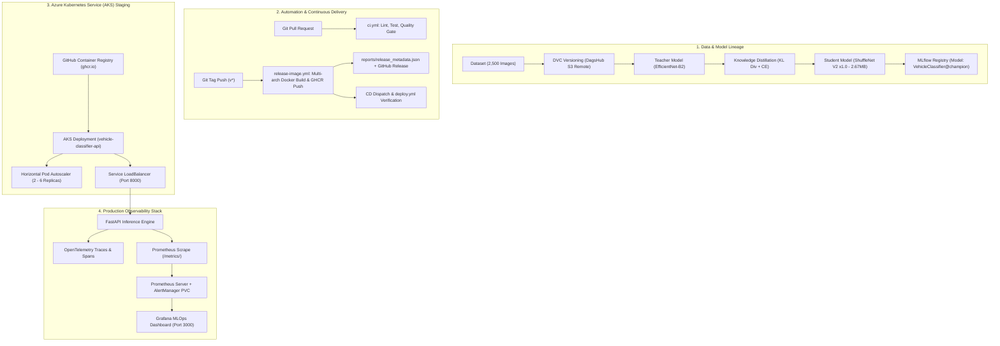

# Memory-Constrained Vehicle Classifier

[](http://20.200.237.154:8000/docs)
[](http://20.249.161.211:3000)
[-blue)](reports/release_metadata.json)
[](reports/evaluation.json)
[-purple)](reports/evaluation.json)

Project handoff docs: [architecture](docs/architecture.md),
[data card](docs/data_card.md), [model card](docs/model_card.md),
[known limitations](docs/known_limitations.md),
[operator runbook](docs/runbook.md), [demo script and FAQ](docs/demo_script.md),
[MLOps Lifecycle Masterclass](docs/MLOPS_LIFECYCLE_MASTERCLASS.md),
and [phase/evidence status](docs/phase_status.md).

Five-class image classifier (`0 Bus`, `1 Truck`, `2 Car`, `3 Bike`, `4 None`) using a **ShuffleNet V2 x1.0 student model (2.67 MB)** distilled from an **EfficientNet-B2 teacher**. Engineered strictly for resource-constrained edge CPU environments: serialized weights under 5 MB, p95 turnaround under 25 ms, zero runtime external downloads, full OpenTelemetry distributed tracing, and automated GitOps continuous deployment to Azure Kubernetes Service (AKS).

---

## 🏛️ System Architecture



---

## 🚀 CI/CD & MLOps Pipelines

The repository features automated, production-grade GitHub Actions workflows ensuring strict quality gates, immutable container attestations, and automated cloud rollouts:

| Pipeline Name | Workflow File | Trigger Event | Primary Purpose & Responsibilities |
| :--- | :--- | :--- | :--- |
| **PR Quality Gate** | `.github/workflows/ci.yml` | `pull_request` to `main`, `workflow_call` | Fast, deterministic CPU verification: enforces `ruff` linting, Python module compilation, pytest unit tests, and model quality gate thresholds without retraining. |
| **Release & AKS Deploy** | `.github/workflows/release-image.yml` | `push: tags: ["v*"]` | Reruns quality gate, validates champion checkpoint hash/sidecar, builds multi-arch Docker image, publishes immutable tags (`v*` and `:latest`) to GHCR, publishes GitHub Release with `release_metadata.json`, deploys to Azure AKS, and triggers CD verification. |
| **Continuous Deployment** | `.github/workflows/deploy.yml` | `repository_dispatch: [model-released]`, `workflow_run`, `workflow_dispatch` | Verifies release metadata lineage, validates Kubernetes manifests against live cluster, performs zero-downtime rolling update on AKS, and runs container health & contract smoke tests. |
| **GPU Distillation Train** | `.github/workflows/train-gpu.yml` | `workflow_dispatch` (Manual) | Runs on self-hosted GPU runner: pulls versioned DVC data, executes teacher training, student distillation, and target/OOD evaluation, pushes DVC lock, and records metrics in MLflow. |
| **DVC Data Lineage** | `dvc.yaml` | `dvc repro` (CLI) | Tracks pipeline stages (`validate_data`, `train_teacher`, `train_student`, `evaluate_target`, `evaluate_ood`), generating deterministic data hashes and metric locks. |

### How Pipelines Cascade on Tag Release
When a release tag is pushed (`git tag v1.0.10 && git push origin v1.0.10`):
1. **`release-image.yml`** starts immediately. It verifies code quality, builds the Docker image with SHA-256 digest attestation, publishes both the versioned tag and `:latest` to GHCR, creates the GitHub release, and performs the live rollout to AKS.
2. At the completion of container publishing, `release-image.yml` emits an authenticated `repository_dispatch` event (`model-released`), triggering **`deploy.yml`**.
3. Upon full workflow completion, the native `workflow_run` hook also triggers **`deploy.yml`** for staging health verification and contract smoke testing.

---

## 🎯 How to Run Inference (4 Ways)

The model can be invoked through four distinct methods depending on your environment:

### Mode 1: Python Code / SDK (In-Process)
Use the high-level Python interface directly in your code or scripts:

```python
from vehicle_classifier import VehicleClassifier

# Instantiate model (loads student_model.pth with integrity check)
classifier = VehicleClassifier("student_model.pth")

# Run prediction on any image file (JPEG, PNG, WEBP)
class_index = classifier.predict("tests/fixtures/sample_car.jpg")
print(f"Predicted class index: {class_index}") # e.g. 2 (Car)

# Class index lookup:
CLASS_MAP = {0: "Bus", 1: "Truck", 2: "Car", 3: "Bike", 4: "None"}
print(f"Class Name: {CLASS_MAP[class_index]}")
```

Or load via MLflow Model Registry alias:
```python
import mlflow
import pandas as pd

model = mlflow.pyfunc.load_model("models:/VehicleClassifier@champion")
prediction = model.predict(pd.DataFrame({"image_path": ["tests/fixtures/sample_car.jpg"]}))
print(prediction)
```

---

### Mode 2: Local HTTP REST API (FastAPI)
Run the production FastAPI service locally:

```bash
# 1. Start the API server on port 8000
uvicorn vehicle_classifier_core.api:app --host 0.0.0.0 --port 8000

# 2. Check health probes
curl -s http://127.0.0.1:8000/health/live
curl -s http://127.0.0.1:8000/health/ready

# 3. Perform prediction via curl (Multipart File Upload)
curl -X POST "http://127.0.0.1:8000/predict" \
  -H "Accept: application/json" \
  -F "file=@tests/fixtures/sample_car.jpg"
```

**Expected JSON Response:**
```json
{
  "predicted_index": 2,
  "class_name": "Car",
  "model_sha256": "c80eaf7a45e87e604b2e41af992094425834e46d747315a6fb66a65f7c18e1d4"
}
```

Interactive OpenAPI Swagger UI is available at **`http://127.0.0.1:8000/docs`**.

---

### Mode 3: Standalone Docker Container
Pull and run the official published container image from GitHub Container Registry (GHCR):

```bash
# 1. Run container from GHCR
docker run -d --name vehicle-classifier -p 8000:8000 \
  ghcr.io/doshivansh/memory_constraint_vehicle_classifier:latest

# 2. Test prediction against the container
curl -X POST "http://127.0.0.1:8000/predict" \
  -F "file=@tests/fixtures/sample_car.jpg"

# 3. Verify zero-network runtime requirement (offline capability)
docker run --rm --network none \
  ghcr.io/doshivansh/memory_constraint_vehicle_classifier:latest \
  python /app/scripts/smoke_test_api.py
```

---

### Mode 4: Live Cloud AKS Cluster (Production Staging)
The application is deployed on Microsoft Azure Kubernetes Service (AKS) with an active public LoadBalancer:

* **Public API Endpoint**: `http://20.200.237.154:8000`
* **Swagger API Documentation**: [`http://20.200.237.154:8000/docs`](http://20.200.237.154:8000/docs)
* **Prometheus Live Metrics**: [`http://20.200.237.154:8000/metrics`](http://20.200.237.154:8000/metrics)
* **Live Grafana MLOps Dashboard**: [`http://20.249.161.211:3000`](http://20.249.161.211:3000)

**Run Live Inference Against the Cloud Cluster:**
```bash
# Health Check
curl -s http://20.200.237.154:8000/health/ready

# Live Prediction
curl -X POST "http://20.200.237.154:8000/predict" \
  -H "Accept: application/json" \
  -F "file=@tests/fixtures/sample_car.jpg"
```

---

## Supported CPU environment

- CPython 3.10, 3.11, or 3.12 (3.13+ is not currently supported by the pinned stack).
- CPU-only PyTorch 2.6.0 and torchvision 0.21.0.
- Pillow 11.1.0, PyYAML 6.0.2, and pytest 8.3.5.
- Linux x86_64 is the reference platform. macOS on Apple silicon/Intel is supported for CPU inference, subject to PyTorch wheel availability. CUDA is not required for inference.

Create a clean environment and install the pinned CPU stack:

```bash
python3.12 -m venv .venv
source .venv/bin/activate
python -m pip install --upgrade pip==25.0.1
python -m pip install -r requirements-cpu.txt
python -m pip install Pillow==11.1.0 PyYAML==6.0.2 pytest==8.3.5
python -m pip install -r requirements-api.txt
python -m pip install ruff==0.17.1
python -m pip install -e . --no-deps
```

`requirements-api.txt` installs the pinned FastAPI/ASGI server and HTTP client
used by the API contract tests.

For GPU training, install the pinned PyTorch/torchvision versions from the official CUDA wheel index matching your driver, then install the remaining packages and this project with `--no-deps` as above. The project configs choose CUDA automatically when that build can access it. PyTorch publishes version-specific CPU and CUDA install commands in its [previous versions guide](https://pytorch.org/get-started/previous-versions/).

## Configuration and commands

Training, evaluation, and data preparation settings live in `configs/`. Configurations set seed `1729` by default; run reports record Python/library versions, platform, Git revision, config, and checkpoint hash. Training data must use the explicit folder names `0_Bus`, `1_Truck`, `2_Car`, `3_Bike`, and `4_None`.

Teacher and student training default to `device: auto`: they use CUDA when the installed PyTorch build can access it, otherwise CPU. The pinned install command above installs the CPU build; GPU training requires installing a CUDA-enabled PyTorch/torchvision build compatible with the system's GPU driver. Inference intentionally remains CPU-only.

```bash
# Install the pinned DVC S3 support. DVC and local RustFS storage are free.
python -m pip install -r requirements-dvc.txt
python -m pip install -r requirements-mlflow.txt

# Create local credentials only if .env does not already exist; .env is ignored
# by Git. Replace DVC_SECRET_KEY with a private value in a newly copied file.
test -f .env || cp .env.example .env
# Start the local DVC object store.
scripts/configure_dvc_remote.sh --start-local-storage

# Create the bucket from the ignored .env credentials, then configure DVC and
# add the existing data. The RustFS console is available at http://127.0.0.1:9001.
python scripts/ensure_dvc_bucket.py
scripts/configure_dvc_remote.sh --track-local-data

# Build the manifest, validate, and upload to RustFS without training.
dvc repro validate_data
dvc push

# On another team computer, configure its .env with the storage host's
# DVC_ENDPOINT_URL and shared team credentials, configure the remote, then pull.
scripts/configure_dvc_remote.sh
dvc pull

# Train the EfficientNet-B2 teacher (pretrained weights are downloaded for training)
python train_teacher.py --config configs/teacher.yaml

# Train the ShuffleNet student by knowledge distillation
python train_distillation.py --config configs/distillation.yaml

# Evaluate a selected checkpoint and write metrics plus a confusion matrix
python evaluate_test_set.py --config configs/evaluation.yaml

# Optional out-of-distribution stress test
python evaluate_mio_tcd.py --config configs/ood_evaluation.yaml

# Run the interface, deterministic split, and metric checks
pytest
```

## Phase 4 inference API and Docker

The FastAPI service loads the packaged CPU checkpoint once at startup, verifies
its metadata and SHA-256, and does not access pretrained weights or the network.
It accepts one multipart `file` upload in JPEG, PNG, or WEBP format. Requests
are capped at 8 MiB and images at 20 megapixels. Successful responses contain
`predicted_index`, `class_name`, and `model_sha256`; malformed images return
HTTP 400, unsupported formats HTTP 415, and size-limit violations HTTP 413.
`/health/live` checks that the process responds; `/health/ready` is successful
only after package validation and model loading. Interactive docs are at
`/docs` when the API is running.

Run it locally after installing `requirements-api.txt`:

```bash
uvicorn vehicle_classifier_core.api:app --host 127.0.0.1 --port 8000
python scripts/smoke_test_api.py
pytest tests/test_api.py
```

Build the image and run a network-isolated container smoke test. The script runs
inside the container and calls the service over loopback, proving inference
does not require runtime access to pretrained-weight downloads:

```bash
docker build -t vehicle-classifier-api:phase4 .
docker run -d --name vehicle-classifier-api --network none vehicle-classifier-api:phase4
docker exec vehicle-classifier-api python /app/scripts/smoke_test_api.py
docker rm -f vehicle-classifier-api
```

For host access during development, run `docker run --rm -p 8000:8000
vehicle-classifier-api:phase4`, then use `python scripts/smoke_test_api.py` from
the repository. Docker packages the checked-in `student_model.pth` and its
generated `student_model.pth.json` integrity/contract metadata. Regenerate the
sidecar after replacing the checkpoint with the newly approved model version,
for example:

```bash
python -m scripts.create_inference_manifest student_model.pth \
  --model-name VehicleClassifier --model-version 2 --model-alias champion
```
The strict 5 MB limit applies to the serialized model weights, not the container;
the verified CPU image is about 1.31 GiB because it includes PyTorch and
TorchVision.

## Phase 5 CI, training runs, and GHCR releases

`.github/workflows/ci.yml` runs on every pull request and is also reused by the
release workflow. It installs CPU PyTorch, runs Ruff, compiles the maintained
Python modules, and runs pytest. It does not fetch DVC datasets or train a
teacher/student model. To run the same checks locally, use `ruff check .` and
`pytest -q`.

The release workflow runs when a `v*` tag is pushed. It reruns the quality gate,
checks that the packaged checkpoint matches the approved `champion` sidecar,
builds and publishes the image to GHCR, then creates a GitHub Release with
`release_metadata.json`. That file binds the Git SHA, MLflow model version,
checkpoint SHA-256, and immutable image digest. Update
`student_model.pth.json` with the approved model version whenever the promoted
checkpoint changes. To release a verified commit:

```bash
git tag v0.1.0
git push origin v0.1.0
```

The tag should point at a commit whose PR quality gate passed. Repository branch
protection must also require the `PR Quality Gate / test-and-static-checks`
status; adding a workflow alone does not prevent merging a failing PR.
The release workflow also reruns this gate before publishing.

The expensive training workflow is manual and targets a self-hosted Linux x64
runner labeled `gpu`. That runner needs an NVIDIA GPU/driver and an Actions
runner version compatible with Node 24 actions (2.327.1 or newer). Choose the
CUDA wheel index that matches the runner's driver when dispatching the workflow.
In repository Settings → Secrets and variables → Actions, add the
`DVC_ENDPOINT_URL` variable and `DVC_ACCESS_KEY` / `DVC_SECRET_KEY` secrets. The
configured endpoint must be reachable from the runner; `127.0.0.1` works only
when RustFS runs on that same host. The workflow pulls the DVC datasets, runs
the DVC teacher/student/evaluation stages, pushes DVC outputs, and saves the
resulting `dvc.lock`, reports, model package, and local MLflow store as a
downloadable Actions artifact. Review and commit an updated `dvc.lock` when you
want that run's stage hashes to become the repository's reproducible reference.
The first teacher-training run also needs internet access to download the
configured ImageNet initialization, unless those weights are already cached on
the runner.

## MLflow experiments and model promotion

MLflow is configured for a free, local setup: run metadata is stored in
`mlflow.db` (SQLite), and artifacts are stored under `mlartifacts/`. Both are
ignored by Git. This local store is for this machine and is not automatically
shared with teammates. Set `MLFLOW_TRACKING_URI` to point the scripts and UI at
the same database if you change the default. `MLFLOW_EXPERIMENT_NAME` can select
a different experiment name.

Start the UI from the repository root in one terminal:

```bash
mlflow server --backend-store-uri sqlite:///mlflow.db --default-artifact-root ./mlartifacts --host 127.0.0.1 --port 5000
```

Run experiments in another terminal. Each invocation creates a new run; change
the YAML values or config file for the second experiment. The dataset manifest
must first exist (Phase 2 `dvc repro`):

```bash
python train_teacher.py --config configs/teacher.yaml
python train_distillation.py --config configs/distillation.yaml
python evaluate_test_set.py --config configs/evaluation.yaml
python evaluate_mio_tcd.py --config configs/ood_evaluation.yaml
```

Open <http://127.0.0.1:5000> to compare runs. Training runs log seed,
hyperparameters, teacher/student identifiers, teacher checkpoint hash where
applicable, Git SHA/working-tree state, data-manifest or DVC-lock fingerprint,
epoch and final metrics, config, and checkpoints. Evaluation runs additionally
log overall, clean/augmented and per-class metrics, confusion matrix, report,
and exact evaluated checkpoint. If no DVC manifest/lock is available, the run
is explicitly tagged `unversioned-local-data`; that run cannot pass promotion.

For a quick tracking demonstration on CPU, these two one-batch distillation
configs create two distinct runs without retraining the full model:

```bash
python train_distillation.py --config configs/experiments/phase3_smoke_a.yaml
python train_distillation.py --config configs/experiments/phase3_smoke_b.yaml
```

They differ in learning rate and distillation weight. Their metrics are only
smoke-run comparisons and must not be used for quality claims or promotion.

After committing the implementation and obtaining a fresh evaluation of the
audited canonical checkpoint on the same data manifest, record the baseline
with explicit confirmation, then use the candidate flow:

```bash
python evaluate_test_set.py --config configs/evaluation.yaml
python scripts/record_baseline.py --evaluation reports/evaluation.json --confirm-canonical
# After training/evaluating a candidate on the same manifest:
python scripts/model_gate.py --evaluation reports/evaluation.json
python scripts/register_candidate.py --evaluation reports/evaluation.json
# Review the candidate and its quality-gate report in MLflow, then explicitly approve:
python scripts/promote_model.py --model-name VehicleClassifier --version 2 --approve
```

Replace `2` with the candidate version number printed by the registration
command. The baseline recorder checks that the evaluated checkpoint hash matches the
audited canonical checkpoint and records the run's Git SHA plus an archived
source snapshot fingerprint. The candidate gate requires its own Git revision
and source snapshot, MLflow run ID, the same dataset-manifest checksum as the baseline, matching checkpoint SHA-256,
accuracy at least equal to the fresh canonical baseline, and a checkpoint
strictly below 5,000,000 bytes. The
historical 92.44% in the current baseline audit is not treated as a fresh gate
threshold. Registration creates a candidate version; assigning the `champion`
alias is a separate command requiring `--approve`. The registered version
points to the checkpoint artifact logged by the evaluation run; serving still
uses the existing `VehicleClassifier` loader with the checkpoint file.

The registered artifact is also an MLflow PyFunc model. After promotion it can
be loaded by its alias:

```python
import mlflow
import pandas as pd

model = mlflow.pyfunc.load_model("models:/VehicleClassifier@champion")
predictions = model.predict(pd.DataFrame({"image_path": ["vehicle.jpg"]}))
```

This wrapper calls the same `VehicleClassifier` implementation and returns
integer class indices.

DVC can execute the manifest and validation stages with `dvc repro validate_data`.

## Phase 6 Kubernetes staging and rollback

The `k8s/` resources define a local staging namespace, CPU Deployment, internal
ClusterIP Service, and release ConfigMap. Probes use `/health/live` and
`/health/ready`; the pod has CPU/memory bounds, runs as a non-root user, and
uses a read-only root filesystem. The checkpoint stays inside the immutable
container image. No managed cluster or cloud budget is needed for this phase.

`Jenkinsfile` deploys only a GHCR `image@sha256:...` reference. It accepts the
complete Phase 5 release metadata JSON and checks that the image digest and
champion model identity belong to the same release, then applies the staging
resources, waits for the rollout, and calls readiness plus a real PNG prediction
through the Service. If rollout or smoke validation fails, it restores the previous
Deployment revision and model ConfigMap, waits for recovery, and smoke-checks
the restored version. A failed first rollout removes the unverified
Deployment. See [the Phase 6 runbook](docs/phase6_runbook.md) for local cluster,
Jenkins credentials, deployment, observation, and cleanup steps.

Phase 6 implementation files are present. A disposable kind cluster has been
used to deploy the locally built Phase 4 image, pass readiness and prediction
smokes, fail a rollout with an unavailable image, manually restore the previous
Deployment revision, and pass the smokes again. The Jenkins pipeline has not
yet been run: it still needs a configured Jenkins agent/credential and a
published GHCR release digest. This local rollback demonstrates Kubernetes
recovery, but does not close the full Jenkins and immutable-release gate.

## Phase 7 monitoring and performance

The inference API exposes bounded-label Prometheus metrics at `/metrics` for
HTTP request/error counts, end-to-end and model-call latency, in-flight requests,
prediction class counts by model version, loaded-model identity, and API process
CPU/memory. `/metrics` and health probes are excluded from user request totals.
Prometheus scrapes the API and evaluates local warning rules; Grafana provisions
an eight-panel dashboard for traffic, errors, latency, class distribution, and
process resources. See [the Phase 7 runbook](docs/phase7_monitoring.md) to start
the local stack, open its UIs through port-forwarding, and repeat the load test.

The local kind demonstration passed a 100-request-per-concurrency run at
concurrency 1, 2, and 4 (300 valid predictions, zero errors), and the dashboard
and Prometheus datasource were verified. Results are recorded in
`reports/phase7_local_load.json` and summarized in the runbook. These synthetic,
same-host measurements are for demonstration only; they are not production
capacity estimates or SLOs. No alert notification contact point is configured.

## Phase 8 end-to-end handoff

The local final pass evaluated the existing champion checkpoint without
retraining, recorded target and OOD evaluation runs in MLflow, validated the
checkpoint/sidecar contract, rebuilt the API image, passed its container smoke
with networking disabled, and rolled that image through the local kind
Deployment. Readiness and a real prediction passed with the expected
checkpoint SHA. Prometheus and Grafana remained available in the local cluster.
The second clean-clone DVC retrieval was blocked by this machine's temporary
storage quota; Phase 2's earlier retrieval is recorded in `docs/phase_status.md`.

Fresh target metrics: 92.40% overall (97.36% clean, 87.44% augmented) on 2,500
fixed samples. Fresh mapped MIO-TCD stress-set accuracy: 43.24%. This OOD score
is a material limitation, not a production quality claim. See
[`docs/model_card.md`](docs/model_card.md) for class metrics, checkpoint SHA,
scope, and known limitations.

Core local end-to-end commands, from a checkout with DVC data available:

```bash
# Retrieve versioned datasets and validate their manifest.
dvc pull
dvc repro validate_data

# Evaluate only the current checkpoint (does not train teacher/student).
dvc repro --single-item evaluate_target
dvc repro --single-item evaluate_ood

# Inspect MLflow runs at http://127.0.0.1:5000.
mlflow server --backend-store-uri sqlite:///mlflow.db \
  --default-artifact-root ./mlartifacts --host 127.0.0.1 --port 5000

# Check the packaged champion checkpoint and sidecar.
python scripts/create_release_metadata.py --validate-only

# Build and exercise API offline; the container runs the API itself.
docker build -t vehicle-classifier-api:local .
docker run -d --name vehicle-classifier-api --network none vehicle-classifier-api:local
docker exec vehicle-classifier-api python /app/scripts/smoke_test_api.py
docker rm -f vehicle-classifier-api
```

For local Kubernetes, use the complete export/render/rollout, port-forward,
Prometheus, Grafana, load-test, diagnosis and rollback commands in
[`docs/runbook.md`](docs/runbook.md). The known kind cluster name is
`vehicle-classifier-phase6`; a fresh machine must first install Docker/kind/
kubectl and create that cluster. Do not confuse this local `:local` image with
the immutable GHCR digest expected by Jenkins.

### Phase 8 evidence and remaining boundary

The DVC single-stage evaluations logged fresh MLflow run IDs and stored
confusion matrices in `reports/evaluation.json` and
`reports/ood_evaluation.json`; both identify checkpoint SHA
`c80eaf7a45e87e604b2e41af992094425834e46d747315a6fb66a65f7c18e1d4` and data
manifest SHA `3c40f2a7c554220c35c98db4b299a29b3f9c6391f2d56a31695796bc8ccfd35a`.
They ran in a Python 3.10.22 CPU container with PyTorch 2.6.0+cpu. The second
clean-clone retrieval did not complete in this pass.

No GitHub release tag was created or image published. GitHub branch protection,
Actions run screenshots, Jenkins agent/credentials, GHCR digest rollout and
Jenkins screenshot remain external setup/evidence. DVC retrieval from a
teammate's computer is also unverified. These limitations are listed in
[`docs/phase_status.md`](docs/phase_status.md) and
[`docs/evidence/README.md`](docs/evidence/README.md). The project is
documented and demonstrated locally, but the full Phase 8 exit gate (“someone
outside the team can run it from a clean clone”) is not yet fully closed.
Actual local MLflow run/model-version and Grafana screenshots, plus the
Kubernetes rollout/rollback transcript, are indexed in
[`docs/evidence/README.md`](docs/evidence/README.md).
The complete ML pipeline (which trains the teacher and student) can be run with
`dvc repro evaluate_target evaluate_ood` when the Phase 2 data and teacher
pretraining weights are available; this may take substantial time.
The MLflow database/artifacts remain local side effects and are not DVC outputs.
The local DVC remote is initialized and populated, and the fresh canonical
baseline and candidate quality gate are recorded. Model version 2 is approved
and assigned the `champion` alias in the local MLflow registry. The two short
training runs are smoke demonstrations rather than full experiment comparisons;
full teacher/student training remains deferred because it is long on the
available CPU-only runtime. DVC access from a collaborator's machine also
remains unverified. See
[phase status](docs/phase_status.md).

`vehicle_dataset`, `test_dataset`, and `test_MIO_TCD_data` are stored in DVC, not Git. The raw `imagenet_raw/` and `mio_tcd_raw/` directories stay local until their redistribution rights are verified. RustFS stores data on the host disk and has no cloud fee; its single-node mode has no redundancy, so keep a backup. It binds to localhost by default. Sharing across computers requires binding to a trusted LAN, setting each client's `DVC_ENDPOINT_URL` to the host address, and keeping RustFS running. Do not expose this development endpoint to the public internet. Keep `.obsidian/` and `.env` private; both are ignored by Git.

The legacy `train.py` entry point delegates to the configured distillation workflow. The historical student checkpoint is small enough for the 5,000,000-byte artifact cap; newly trained artifacts are checked against the same cap and accompanied by a JSON metadata file.

## Code layout

- `vehicle_classifier_core/model.py`: model architecture and class map.
- `vehicle_classifier_core/preprocessing.py`: shared training and inference transforms.
- `vehicle_classifier_core/data.py`: class-map validation and seeded train/validation split.
- `vehicle_classifier_core/predictor.py`: CPU inference; exported through `vehicle_classifier.py` for compatibility.
- `vehicle_classifier_core/evaluation.py`: classwise metrics and confusion matrix.
- `vehicle_classifier_core/packaging.py`: checkpoint manifest, checksum, and size.
- `vehicle_classifier_core/reproducibility.py`: random seeds, JSON logs, run metadata.
- `vehicle_classifier_core/tracking.py`: MLflow run metadata and artifact logging.
- `vehicle_classifier_core/model_gate.py`: fresh-baseline and strict artifact-size gate.
- `docs/baseline_audit.md`: Phase 0 audit and current baseline status.
- `docs/phase_status.md`: implementation progress versus pending exit-gate evidence.
