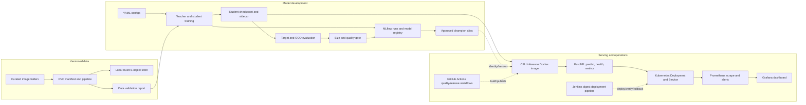

# System architecture

## Data and control flow

Git stores code, small configuration, DVC pointers, Kubernetes manifests, and
documentation. DVC stores checksummed dataset/model objects in the configured
object store; this project currently uses a free local RustFS instance. DVC
stage hashes express dependencies and outputs. MLflow stores run parameters,
metrics, lineage, and model versions in the local SQLite/artifact store.

The inference container includes the approved checkpoint and integrity sidecar,
so runtime prediction does not download weights. The API serves CPU inference,
reports bounded-label request and prediction metrics, and is deployed behind a
ClusterIP. Prometheus scrapes those metrics; Grafana reads Prometheus. GitHub
Actions and Jenkins are implemented as automation definitions, but remote
GitHub publication and Jenkins deployment remain pending external setup.
