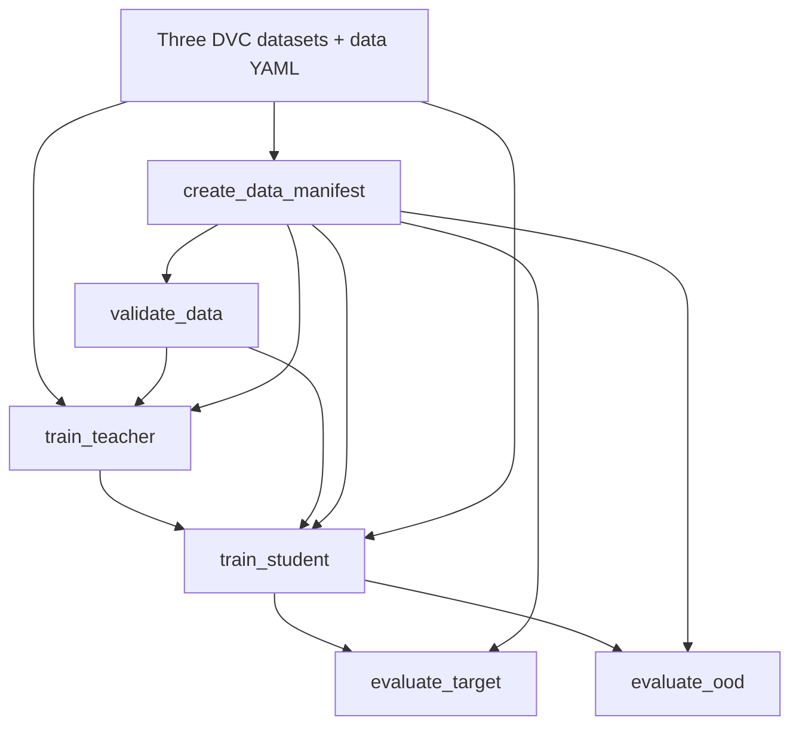

# Vehicle Classifier MLOps Project: Comprehensive Beginner's Manual

> **Audience:** a reader who is new to machine learning operations (MLOps),
> DevOps, containers, model registries, CI/CD, and Kubernetes.
>
> **Scope note:** this manual documents the repository as it exists when this
> file was written. It distinguishes implemented files from workflows that
> still need account-side setup. A YAML workflow being present does not prove
> that a GitHub runner or Jenkins server has executed it. Local screenshots
> are local evidence, not evidence of a remote deployment.
>
> **About “every file”:** the repository includes source code, configuration,
> documentation, reports, binary model/data files, PDFs, local-state files,
> and more than one hundred thousand image files. The control-bearing text
> files are explained individually below. Dataset images are explained as
> records with class, split, content hashes, and lineage, not as if each JPEG
> contained a separate program. Binary reports/checkpoints/PDFs are explained
> by their file contract and purpose; a binary file has no source-code lines
> to narrate. Ignored local secrets, caches, and Obsidian settings are covered
> by policy but their contents are not reproduced.
>
> **Reading order:** first learn the concepts and end-to-end flow; then follow
> the phase sections; finally use the per-file catalog and command references.

## Executive Summary of MLOps

### What problem does MLOps solve?

A machine-learning model is more than a `.pth` file. A prediction depends on
the exact model architecture, checkpoint bytes, input resizing and
normalization, class-index mapping, data version, code revision, runtime
libraries, and serving configuration. If any of those change unnoticed, two
people can run “the same model” and get different results, or a deployment
can serve a checkpoint that was never evaluated.

MLOps applies software-engineering and operations practices to machine
learning. It makes the path from data to production inspectable and repeatable:

1. **Version the inputs.** Record which data files and transformations were
   used. This project uses Git for code/configuration and DVC for large data
   files and pipeline outputs.
2. **Make experiments traceable.** Store parameters, metrics, environment,
   code/data identifiers, and artifacts for each run. This project uses MLflow.
3. **Evaluate before promotion.** Compare a candidate against an agreed
   baseline, enforce size/quality rules, and require a human approval step.
4. **Package an exact model.** Bind model bytes to a checksum, architecture,
   class order, and preprocessing contract. Put those bytes in an inference
   container so serving does not download weights at runtime.
5. **Automate delivery.** Run fast checks for code changes; build and publish
   immutable release images only from approved revisions; deploy, check health,
   and recover if a rollout fails.
6. **Observe real service behavior.** Record request counts, failures, latency,
   resource use, and prediction counts so operators can see what the system is
   doing.

MLOps does **not** make a model accurate by itself. It makes the evidence and
process around a model more reliable. This distinction matters here: the
current model scores 92.40% on the fixed target evaluation set but only 43.24%
on the mapped MIO-TCD stress set. Reproducible operations can make that weak
generalization visible; they cannot erase it.

### What this project does

The project classifies a single image into one of five labels: Bus, Truck, Car,
Bike, or None. A comparatively large EfficientNet-B2 teacher can guide a small
ShuffleNet V2 x1.0 student through knowledge distillation. The student
checkpoint is about 2.67 MB and is loaded by a CPU inference interface. FastAPI
provides an HTTP endpoint. Docker packages the API and checkpoint. Kubernetes
can run the container locally in kind. Prometheus scrapes operational metrics,
and Grafana displays them.

The training and release system is designed around five identity values:

| Identity | Example/current meaning |
|---|---|
| Class mapping | `0 Bus`, `1 Truck`, `2 Car`, `3 Bike`, `4 None` |
| Preprocessing contract | RGB, 224 × 224, ImageNet mean/std |
| Model artifact identity | Checkpoint SHA-256 `c80eaf7a45e87e604b2e41af992094425834e46d747315a6fb66a65f7c18e1d4` |
| Dataset identity | Manifest SHA-256 `3c40f2a7c554220c35c98db4b299a29b3f9c6391f2d56a31695796bc8ccfd35a` |
| Code identity | Git commit SHA, plus a source snapshot hash for the run |

The currently approved local model-registry entry is `VehicleClassifier`
version `2`, alias `champion`. The local alias is stored in local MLflow state;
it does not automatically travel with Git or appear in GitHub.

### What the system does not yet prove

- The DVC object store currently used is a local RustFS service. It is not
  automatically available to a teammate or a hosted GitHub runner.
- The clean-clone DVC retrieval was previously reported successful in Phase 2,
  but a Phase 8 repeat ran out of temporary storage before all data arrived.
- GitHub workflows exist in the repository, but repository branch protection,
  hosted workflow results, and a published GHCR image have not been evidenced
  in this workspace.
- Jenkins pipeline code exists, but a configured Jenkins agent, kubeconfig
  credential, and immutable GHCR digest deployment remain external setup.
- No release tag was created. The current decision was to defer a versioned
  release.
- Dataset source/licensing provenance is not fully verified. The MIO-TCD
  `pedestrian` and `background` categories were mapped to `None`; that is an
  imperfect semantic match.
- Local synthetic load measurements are not an SLO or production capacity
  guarantee. There is no labeled production feedback pipeline.

See [`docs/known_limitations.md`](docs/known_limitations.md) for the concise
limitations register and what evidence would close each gap.

## Project Architecture Overview

### A mental model before reading the code

Think of the repository as several connected but distinct systems:

- **Git repository:** the recipe book. It stores source code, YAML configs,
  pipeline definitions, small metadata, tests, and documentation.
- **DVC:** the ingredient inventory and build graph. It records content hashes
  for large datasets and links stages such as manifest creation, validation,
  training, and evaluation.
- **MLflow:** the lab notebook and model catalog. It records experiments,
  metrics, parameters, artifacts, registered model versions, and aliases.
- **Checkpoint sidecar:** the model's identity card. It binds bytes to class
  labels, architecture, preprocessing, size, checksum, and model version.
- **Docker image:** a packaged computer environment containing the API,
  Python libraries, and model weights.
- **Kubernetes:** a manager that starts containers, replaces failed ones,
  routes traffic, and checks readiness/liveness.
- **Prometheus/Grafana:** the measurement and dashboard system. Prometheus
  collects time-series measurements; Grafana charts them.
- **GitHub Actions/Jenkins:** automation engines. Actions runs repository
  workflows; Jenkins orchestrates staging deployment and rollback.

### Architecture diagram

The canonical repository diagram is in [`docs/architecture.md`](docs/architecture.md).
The same flow is summarized below:

```mermaid
flowchart LR
  Data[Curated image folders] --> DVC[DVC hashes and stages]
  DVC --> Manifest[Manifest and validation]
  Manifest --> Train[Teacher and student training]
  Train --> Checkpoint[Student checkpoint and sidecar]
  Train --> MLflow[MLflow experiment and registry]
  Checkpoint --> Evaluate[Target and OOD evaluation]
  Evaluate --> Gate[Baseline and strict size gate]
  Gate --> Approve[Human approval and champion alias]
  Checkpoint --> Image[CPU Docker image]
  Approve -. model identity .-> Image
  Image --> API[FastAPI inference + metrics]
  API --> K8s[Kubernetes Deployment/Service]
  K8s --> Prometheus[Prometheus scrape/alerts]
  Prometheus --> Grafana[Grafana dashboard]
  GitHub[GitHub Actions] -. quality/release .-> Image
  Jenkins[Jenkins] -. digest deploy/check/rollback .-> K8s
```



### Data plane and control plane

The **data plane** is what handles image data and predictions: dataset files,
model, API, Kubernetes pods, and metrics. The **control plane** decides which
artifacts and versions are allowed to move forward: Git revisions, DVC stage
hashes, MLflow run/model metadata, quality-gate scripts, GitHub workflow
results, Jenkins input metadata, and Kubernetes rollout history.

The distinction is useful during debugging. If predictions are wrong, inspect
the checkpoint, preprocessing, labels, and input data. If the wrong checkpoint
was deployed, inspect the release metadata, MLflow version, image digest, and
deployment revision.

### End-to-end run in plain language

1. The dataset folders are materialized locally using DVC pointers.
2. A deterministic manifest records each image's relative path, data role,
   class, split, dimensions, byte size, file SHA-256, and a visual difference
   hash used to find possible near-duplicates.
3. A validator checks the manifest and image files for missing classes,
   unreadable files, duplicate hashes, and cross-split leakage.
4. Training code reads a YAML config, seeds random generators, builds image
   loaders, trains the teacher/student, logs an MLflow run, and saves a model
   checkpoint plus metadata.
5. Evaluation loads a checkpoint using the same class/preprocessing contract,
   predicts on fixed target and OOD sets, computes metrics/confusion matrices,
   and records MLflow runs.
6. A gate compares the candidate with a fresh canonical baseline and enforces
   a strict checkpoint size limit. Registration marks it as a candidate;
   separate explicit approval assigns `champion`.
7. Package validation checks the model sidecar and checkpoint bytes. Docker
   builds an API image with the weights already inside.
8. CI checks code without doing expensive full training on normal pull
   requests. A release workflow can build/push the image and produce metadata
   connecting the Git commit, model, artifact checksum, and image digest.
9. Jenkins validates that metadata and deploys the digest to a Kubernetes
   staging namespace. It waits for rollout and runs real readiness/prediction
   smoke calls. Failure prevents promotion and triggers rollback logic.
10. Prometheus scrapes metrics and Grafana visualizes rates, latency, errors,
    prediction classes, and process resources.

## Beginner Foundations

### Image classification, labels, logits, and predictions

An image classifier is a function that maps an image to one of a fixed set of
categories. In training, a sample consists of an image and its expected label.
The model computes one score per class. These raw scores are called **logits**.
The largest logit's position is the predicted class index. Here there are five
logits, and index 0 means Bus, index 1 means Truck, index 2 means Car, index 3
means Bike, index 4 means None.

An integer is not self-explanatory. If one component thinks index 2 means Bike
while another thinks it means Car, the service still returns a valid integer
but the semantic output is wrong. The class mapping is therefore part of the
model contract, not incidental code.

### Training, validation, test, and OOD data

- **Training data** is used to adjust model weights.
- **Validation data** is separated from training and used to select/check
  candidate checkpoints while training.
- **Test data** is reserved for a final estimate against a fixed target domain.
- **Out-of-distribution (OOD) data** deliberately differs from the expected
  distribution. It stress-tests generalization; its score is not interchangeable
  with target-test accuracy.

The code creates a deterministic train/validation split using seed 1729 and
manifest hashes. Test and OOD folders are fixed inputs. A high test result
only describes those examples and that mapping; it is not a guarantee on every
road, camera, geography, weather condition, or image source.

### Preprocessing and normalization

Neural networks expect tensors, not arbitrary image files. This project opens
images, converts them to RGB, resizes to 224 × 224, converts pixels into
floating-point tensor values, and normalizes each color channel using ImageNet
mean `(0.485, 0.456, 0.406)` and standard deviation `(0.229, 0.224, 0.225)`.
Training can add random flips, affine changes, color jitter, and erased regions
to make the student less dependent on one exact visual appearance.

Training and inference must agree on the non-random preprocessing. If the model
was trained on normalized RGB 224 × 224 tensors but serving provides BGR 256 ×
256 values, the same checkpoint can perform badly even though loading succeeds.
The sidecar and startup validator make that contract explicit.

### Random seeds and determinism

Algorithms can use random numbers for shuffling, augmentations, initialization,
and GPU kernels. A seed initializes those random-number generators so a run
can repeat many of the same choices. `seed_everything` seeds Python and
PyTorch and sets deterministic algorithm behavior where available. A fixed
seed improves repeatability; it does not promise bit-for-bit identical GPU
results across different drivers, devices, library builds, or kernel
implementations.

### Teacher/student knowledge distillation

The **teacher** is a larger EfficientNet-B2 network. The **student** is a
smaller ShuffleNet V2 x1.0 network. Ordinary supervised training asks the
student to match the hard label, such as “Bus.” Distillation also asks the
student to imitate the teacher's softer distribution over classes. For
example, a teacher might assign high probability to Bus and some probability
to Truck; that relative information can be useful even when the hard answer is
Bus.

The student loss combines cross-entropy against the true labels and a
Kullback-Leibler divergence between softened teacher/student distributions.
The `alpha` setting controls the balance; `temperature` softens logits. The
student checkpoint is the small artifact intended for inference. The teacher
is a training dependency and is not bundled into the inference container.

### CPU and GPU roles

Training config uses `device: auto`: CUDA is selected if the installed
PyTorch build can access it; otherwise CPU is selected. A machine having an
NVIDIA GPU is not enough if the Python environment installed a CPU-only
PyTorch wheel or its driver is incompatible. Explicit `device: cuda` fails
clearly when CUDA cannot be accessed. The Docker inference image deliberately
uses CPU PyTorch for a portable, lower-complexity serving path. GPU training
and CPU inference are compatible design choices because they are separate
workloads.

### Git, DVC, MLflow, and their different jobs

| Tool | Beginner analogy | Tracks here |
|---|---|---|
| Git | Recipe/history book | Code, config, manifests definitions, tests, docs, workflow YAML, DVC pointer files |
| DVC | Large-file index and dependency graph | Data/checkpoint outputs by content hash, stage dependencies, `dvc.lock` |
| MLflow Tracking | Experiment notebook | Run parameters, metrics, tags, artifacts, source snapshots |
| MLflow Registry | Approved model catalog | Named model versions, tags, aliases such as `champion` |
| Docker | Shipping crate with a known interior | Python runtime, dependencies, API source, model checkpoint/sidecar |
| Kubernetes | Container fleet manager | Replicas, service routing, probes, resources, rollout revisions |
| Prometheus | Time-series collector | Numeric metrics scraped over HTTP |
| Grafana | Dashboard | Queries and panels backed by Prometheus |

Git is not an efficient place for millions of image bytes. DVC keeps tiny
pointer files in Git and puts content-addressed objects in an external remote.
MLflow is not a substitute for DVC: MLflow describes what happened in a run;
DVC describes the data/stage graph and its versioned outputs.

### Reproducibility, traceability, and immutability

- **Reproducibility:** another run can use the same inputs/config/code and
  produce comparable outputs.
- **Traceability:** a report can answer which model/data/code/config produced
  it.
- **Integrity:** SHA-256 checks whether the bytes changed.
- **Immutability:** a reference identifies fixed bytes rather than a moving
  label. An immutable image reference contains an image name, an at-sign, the
  literal `sha256:` prefix, and a 64-character lowercase hexadecimal digest.
  A mutable tag such as `latest` can point elsewhere later.
- **Promotion:** approval changes which registered version is called
  `champion`; it does not magically retrain or alter checkpoint contents.

## Phase 0 — Baseline audit and design contract

### Objective and outputs

Phase 0 asks, “What exactly are we starting from?” before automation makes an
incorrect assumption repeatable. It audits architecture, classes,
preprocessing, checkpoint size/hash, data roles, class-wise metrics, and
confusion matrices. The current baseline references the ShuffleNet student,
the five labels, and a fixed test manifest. Current reports and the audit are
in `reports/baseline.json`, `reports/evaluation.json`,
`reports/ood_evaluation.json`, and `docs/baseline_audit.md`.

The baseline's job is not to claim the model is good. It supplies a named,
versioned point of comparison. `scripts/record_baseline.py` requires an
explicit `--confirm-canonical` flag and checks that the checkpoint hash equals
the audited checkpoint before refreshing the canonical fresh-run section.

### Why exact artifacts matter

A checkpoint filename such as `student_model.pth` is only a label. Someone can
replace its contents without changing its name. SHA-256 produces a digest of
the exact bytes. The baseline, evaluation report, package sidecar, and release
metadata use hashes so that “checkpoint produced the score” can be verified.
The manifest hash serves the same role for dataset contents.

### Phase 0 files

#### `docs/baseline_audit.md`

- **Identity and purpose:** human-readable record of the baseline audit and
  what remains provisional.
- **Primer:** an audit is a snapshot of assumptions and measured starting
  state; it is not the training pipeline itself.
- **Environment:** read in the repository and by reviewers; it runs nowhere.
- **Block walkthrough:** sections describe the model, labels/preprocessing,
  artifact, dataset/evaluation, and unresolved decisions; the file directs the
  reader to machine-readable reports for exact numbers.
- **Why:** fixes a common MLOps failure—changing labels, model, or dataset
  silently while still comparing results as if they were equivalent.
- **MLOps contribution:** creates a shared baseline contract and a clear
  boundary between measurement and team ratification.

#### `reports/baseline.json`

- **Identity and purpose:** structured source of canonical baseline identity,
  metrics, model/checkpoint metadata, and a `fresh_run` section.
- **Primer:** JSON is machine-readable key/value data; scripts can check it
  without scraping prose.
- **Environment:** generated locally by the evaluation/baseline scripts; CI
  may validate it from the checked-out file.
- **Block walkthrough:** model metadata identifies architecture and checksum;
  data/run metadata identifies the evaluation; `fresh_run` holds the run used
  for current promotion comparisons; metrics include accuracy/per-class
  results and matrix.
- **Why:** ensures promotion compares like-with-like and does not use a stale
  historical score as a current baseline.
- **MLOps contribution:** machine-enforced comparison and lineage anchor.

#### `scripts/record_baseline.py`

- **Identity and purpose:** safely records an evaluation as the fresh canonical
  baseline only after an explicit operator confirmation.
- **Primer:** a command-line interface turns a reviewed action into a repeatable
  command; a guard flag prevents accidental mutation.
- **Environment:** developer/maintainer Python environment with repository
  files and an evaluation JSON.
- **Block walkthrough:** parses evaluation/baseline paths and the required
  confirmation; loads both JSON files; checks the candidate checkpoint SHA
  against the baseline model SHA; requires MLflow run, manifest, Git revision,
  and source snapshot IDs; copies the fresh run identity and metrics into the
  baseline JSON.
- **Why:** historical baselines should not be silently overwritten by a
  different checkpoint or untraceable evaluation.
- **MLOps contribution:** controlled and auditable baseline refresh.

## Phase 1 — Code cleanup and reproducible configuration

### Project package and import boundaries

The `vehicle_classifier_core` package separates architecture, preprocessing,
data preparation, evaluation, reproducibility, packaging, tracking, API, and
gates. Small utility imports should not unexpectedly initialize a model or
download weights. `vehicle_classifier_core/__init__.py` deliberately has no
eager imports for that reason.

### `vehicle_classifier_core/__init__.py`

- **Purpose:** marks the directory as a Python package while keeping import
  side effects low.
- **Primer:** Python packages group modules; importing a package may execute
  `__init__.py`.
- **Environment:** any Python process importing the package.
- **Blocks:** its module docstring explains the intended side-effect-free
  behavior; it does not import torch/model code.
- **Why:** lightweight data/config tools can import package modules without
  loading the full inference stack unnecessarily.
- **MLOps role:** reduces hidden startup dependencies and makes automation
  easier to isolate.

### `vehicle_classifier_core/config.py`

- **Purpose:** loads YAML configuration safely and normalizes parse/read errors.
- **Primer:** YAML is a human-editable configuration format; “safe load” reads
  ordinary data structures instead of constructing arbitrary Python objects.
- **Environment:** training, evaluation, dataset scripts, and tests on the
  host or CI runner.
- **Blocks:** `Path(path)` makes path handling explicit; the configured file
  is opened with UTF-8 encoding; `yaml.safe_load` parses it; `OSError` and YAML
  parsing errors are turned into actionable `ValueError`s; the final root
  must be a mapping/dictionary.
- **Why:** hyperparameters and paths should be reviewed without editing source
  code, and malformed config should fail early.
- **MLOps role:** reproducible, reviewable run configuration.

### `vehicle_classifier_core/reproducibility.py`

- **Purpose:** shared tools for deterministic setup, device choice, structured
  logging, checksums, Git identity, environment capture, and run reports.
- **Primer:** a checksum fingerprints file bytes; a Git SHA fingerprints a
  commit; a structured log stores fields as JSON so machines can query logs.
- **Environment:** host training/evaluation processes, local tools, or CI
  runner; it is also imported by packaging and tracking.
- **Block walkthrough:** `JsonLogFormatter` creates timestamp/level/logger/
  message fields and adds contextual extras and exception text. `configure_logging`
  installs it as the root handler. `seed_everything` seeds Python and torch,
  including CUDA generators, and can request deterministic algorithms.
  `resolve_device` returns CPU/CUDA for `auto` or an explicit setting and
  rejects unavailable CUDA. `git_revision` and dirty-state helpers call Git;
  the code-specific helper ignores known generated paths. `file_sha256` streams
  a file in 1 MiB chunks. `run_metadata` records Python/platform/library/GPU,
  config, and optional checkpoint details. `write_run_metadata` writes JSON.
- **Why:** runs must explain the environment and exact file identity; device
  fallback should be explicit rather than hidden.
- **MLOps role:** reproducibility, observability, checksum lineage, CPU/GPU
  portability.
- **Nuance:** the full worktree dirty flag includes generated state; tracking's
  code-specific lineage flag excludes expected outputs. A report can therefore
  show different booleans for those two scopes.

### `vehicle_classifier_core/model.py`

- **Purpose:** defines the five-class student network and canonical class map.
- **Primer:** a neural-network module is a composition of layers; the final
  fully connected layer maps learned features to class logits.
- **Environment:** training, inference, MLflow pyfunc loading, tests.
- **Blocks:** imports PyTorch layer definitions and TorchVision factory;
  `CLASS_IDX` establishes fixed integer-to-label order; `StudentShuffleNet`
  builds ShuffleNet V2 x1.0 with `weights=None` and replaces its default final
  head with five outputs; `forward` delegates input tensors through the model;
  `build_student_model` is a small named factory.
- **Why:** one canonical architecture must be constructed identically for
  training and inference. `weights=None` avoids a hidden pretrained download
  during inference model construction.
- **MLOps role:** architecture contract, packaging repeatability, offline
  serving.

### `vehicle_classifier_core/preprocessing.py`

- **Purpose:** centralizes input transforms shared by training/evaluation/
  inference.
- **Primer:** augmentation creates varied training examples; normalization
  scales channels to the distribution expected by ImageNet-initialized models.
- **Environment:** Python processes loading image datasets or handling API
  predictions.
- **Blocks:** constants set 224 × 224 and channel means/stds. `inference_transform`
  resolves overrides from optional config and composes resize, tensor
  conversion, normalization. `training_transform` resolves both augmentation
  and preprocessing settings, then composes resize, random horizontal flip,
  random affine transform, color jitter, tensor conversion, normalization,
  and random erasing.
- **Why:** training and serving need the same deterministic preprocessing
  contract; only training adds randomness.
- **MLOps role:** prevents train/serve skew and lets package validation detect
  contract mismatch.

### `vehicle_classifier_core/predictor.py`

- **Purpose:** backward-compatible, CPU-only prediction class.
- **Primer:** an inference wrapper hides model setup and transforms behind a
  stable method that client code can call.
- **Environment:** host scripts, API container, tests, legacy callers.
- **Blocks:** `InferenceError` provides a domain-specific error type.
  `VehicleClassifier.__init__` selects CPU, constructs the student, optionally
  reads a checkpoint with `weights_only=True` and `map_location=cpu`, applies
  strict state-dict loading, switches to evaluation mode, and creates the
  inference transform. `predict` opens a path, converts to RGB, and calls
  `predict_image`; `predict_image` preprocesses one PIL image, adds a batch
  dimension, runs under `torch.inference_mode`, chooses `argmax`, and returns a
  Python integer. Logging and exception wrapping give useful failures.
- **Why:** retains the public `VehicleClassifier.predict(image_path) -> int`
  interface while using the new modular core.
- **MLOps role:** stable serving contract, CPU portability, secure checkpoint
  loading, shared implementation for tests and API.

### `vehicle_classifier.py`

- **Purpose:** public compatibility facade and small direct-use example.
- **Primer:** a facade re-exports stable public names while internal modules
  can be rearranged.
- **Environment:** imported by older scripts and notebooks; its `__main__`
  demonstration runs on a developer machine.
- **Blocks:** imports class map, model, error, and predictor; `__all__` states
  the public names; direct execution loads the default checkpoint, predicts
  `test_image.jpg`, and prints index and label.
- **Why:** callers using the historical module path continue to work.
- **MLOps role:** controlled API compatibility during refactoring.

### `vehicle_classifier_core/data.py`

- **Purpose:** constructs train and validation `DataLoader`s with validated
  labels and deterministic splits.
- **Primer:** a dataset reads samples; a data loader groups samples into
  batches for training; a subset selects sample indices without copying images.
- **Environment:** local or GPU CI training process.
- **Blocks:** `validate_training_class_mapping` checks exact folder order and
  ImageFolder mapping. `make_train_validation_loaders` validates the fraction,
  constructs separate augmented and non-augmented ImageFolder objects, ensures
  they see the same samples/labels, optionally reads manifest SHA hashes to
  keep identical-file groups together, computes split indices, wraps datasets
  in `Subset`, seeds the shuffle generator, creates loaders, logs sample
  counts, and returns both. `class_name_to_index` exposes the canonical map.
- **Why:** avoids label drift and exact duplicate images crossing a split.
- **MLOps role:** repeatable data preparation and leakage prevention.

### `vehicle_classifier_core/evaluation.py`

- **Purpose:** computes confusion matrix and class-level accuracy without
  printing or logging assumptions.
- **Primer:** a confusion matrix counts actual-vs-predicted class pairs; rows
  represent truth and columns represent predictions in this implementation.
- **Environment:** evaluation code and unit tests.
- **Blocks:** `confusion_matrix` checks each integer is in range and increments
  a torch integer matrix. `classification_report` verifies equal list lengths,
  derives support and diagonal-correct counts, computes per-class accuracy
  where support is nonzero, totals overall accuracy, and returns JSON-ready
  values.
- **Why:** class-wise results reveal weaknesses hidden by one overall number.
- **MLOps role:** comparable machine-readable evaluation output.

### `vehicle_classifier_core/packaging.py`

- **Purpose:** saves a state dictionary and sidecar metadata.
- **Primer:** a state dictionary stores learned parameter tensors; a sidecar
  JSON describes the artifact contract.
- **Environment:** student training and model packaging on the training host.
- **Blocks:** parent directories are created; `torch.save` writes model
  weights; file size is checked against optional exclusive cap; metadata
  captures architecture, classes, preprocessing, filename, SHA, size, Git
  revision, config, and metrics; `.json` is written adjacent to checkpoint.
- **Why:** the output must be verifiable, small enough for the serving
  constraint, and self-describing.
- **MLOps role:** artifact integrity and release contract.

### `vehicle_classifier_core/artifact_validation.py`

- **Purpose:** validates a serving checkpoint and its JSON sidecar before API
  startup.
- **Primer:** fail-fast validation prevents the service from starting on an
  incompatible or corrupted model.
- **Environment:** inside the Docker API container during FastAPI lifespan;
  also unit tested locally.
- **Blocks:** constants state strict limit and architecture. The function
  checks files exist, size is positive and below five million bytes, parses
  JSON, checks architecture/class mapping/preprocessing, compares byte size,
  recalculates SHA-256, and returns validated identity values.
- **Why:** loading a tensor alone does not prove that class indices or input
  transforms match the current API.
- **MLOps role:** prevents artifact drift at deployment time.

### `vehicle_classifier_core/data_versioning.py`

- **Purpose:** creates and validates the per-image data manifest, computes
  stable splits, and detects duplicate/leakage risks.
- **Primer:** a manifest is a catalog of exact data objects and their roles.
  A cryptographic hash detects identical bytes; a perceptual hash can suggest
  visually similar images even if they were re-encoded. A BK-tree is a search
  structure that finds nearby hashes efficiently.
- **Environment:** local DVC stages or CI data-validation jobs. It does not
  upload data itself.
- **Block walkthrough:** `CANONICAL_CLASSES` and suffix set define expected
  inputs. `split_indices` groups records by optional content ID, shuffles
  groups with a local seeded RNG, fills the requested validation share, and
  returns sorted train/validation indices. `sha256_file` streams bytes.
  `difference_hash` converts an image to grayscale 9×8 and compares neighboring
  pixels to produce 64 bits. `_class_directories` checks class folder names.
  `_assign_split` assigns dataset role/split consistently. `create_manifest`
  walks configured datasets, opens images, records metadata and hashes, and
  returns a versioned document. `_BKTree` indexes perceptual hashes by
  Hamming distance. `validate_manifest` verifies required fields and dataset
  coverage, rechecks readability/records, finds exact duplicates and possible
  near-duplicates, checks for cross-split leakage, and returns status/errors/
  warnings rather than silently changing user data. `write_json` writes stable
  indented JSON.
- **Why:** DVC can say that a directory changed, but a manifest makes each
  sample's class/split and observed properties reviewable.
- **MLOps role:** data lineage, reproducible splitting, duplicate/leakage
  diagnostics, auditable warnings.

### Dataset-preparation programs

#### `dataset_organizer.py`

- **Purpose:** legacy/preparation utility that maps ImageNet-style synset
  directories into the five project class folders.
- **Primer:** a synset is a source taxonomy ID; curation maps several source
  IDs into one project label.
- **Environment:** developer's local machine, reading an extracted local source
  dataset and writing a curated training folder. It is not an API or CI
  runtime step.
- **Block walkthrough:** `CLASS_MAPPING` maps Bus/Truck/Car/Bike/None to
  source synset directory names. `organize_dataset` rejects a nonempty output
  folder to avoid stale files, creates prefixed class directories, gathers
  JPEG/PNG paths, shuffles them using a local seed, caps each class, and copies
  the selected images with stable class/index filenames. The CLI reads
  `configs/data.yaml`, seeds utilities, and invokes the function with configured
  source/destination/cap.
- **Why:** turns a large taxonomic source tree into the `ImageFolder` layout
  expected by training.
- **MLOps role:** repeatable data curation entry point. The source-to-curated
  provenance is still incomplete, so it must not be treated as proof of legal
  redistribution rights.

#### `build_test_data.py`

- **Purpose:** legacy utility to build a fixed target evaluation set from the
  same synset source family.
- **Primer:** a fixed test set must not be regenerated differently every time;
  clean and corrupted/augmented subsets reveal sensitivity to input changes.
- **Environment:** local curation machine with raw source images; not run by
  the API.
- **Block walkthrough:** reads seed/source paths/counts/corruption parameters
  from `configs/data.yaml`; refuses to mix into a nonempty destination; maps
  synsets to classes; defines clean resizing and a corruption pipeline with
  flip, affine, color jitter, tensor conversion, random erasing, and conversion
  back to PIL; shuffles candidates; caps samples per class; splits them into
  clean/augmented halves; saves named JPEGs and reports per-file processing
  errors.
- **Why:** provides a stable local target set with both ordinary and degraded
  examples.
- **MLOps role:** controlled test-data construction. Once materialized, the
  fixed set is versioned via DVC rather than recreated as part of each model
  run.

#### `build_mio_tcd_test.py`

- **Purpose:** maps an extracted MIO-TCD/Kaggle class tree to the five project
  labels and creates an external-domain stress set.
- **Primer:** OOD testing measures how behavior changes on data unlike the
  target training distribution; label mapping itself can introduce errors.
- **Environment:** local dataset-preparation machine with source directory
  `mio_tcd_raw/train1`.
- **Block walkthrough:** hardcodes source/destination and mapping; refuses to
  mix with an existing output; maps source vehicle classes to target labels
  and pedestrian/background to `None`; applies resize and corruption
  transforms; shuffles and selects up to 500 images per target class; saves
  half clean and half augmented, skipping unreadable files.
- **Why:** measures distribution shift on an independent data source.
- **MLOps role:** stress testing and explicit schema mapping. The `None`
  mapping is semantically imperfect and is called out in the model/data cards.

### `scripts/create_data_manifest.py`

- **Identity and purpose:** command-line wrapper around `create_manifest`.
- **Primer:** keeping a small CLI separate from manifest logic makes the core
  functions easy to test and lets DVC call them as a stage.
- **Environment:** local Python environment invoked by DVC.
- **Blocks:** argparse accepts config and output paths; `load_config` reads
  YAML; `create_manifest` uses configured datasets, seed, and validation
  fraction; `write_json` persists output; final print states record count.
- **Why:** one reproducible command constructs the current manifest.
- **MLOps role:** versioned DVC stage with explicit inputs/outputs.

### `scripts/validate_data_manifest.py`

- **Identity and purpose:** loads manifest, runs validator, writes a report,
  and returns a failure exit status if validation failed.
- **Primer:** process exit codes let DVC/CI know whether a command succeeded
  without reading its console text; `0` means success, nonzero means failure.
- **Environment:** local or CI Python process after manifest creation.
- **Blocks:** argparse exposes manifest/output/near-duplicate distance;
  standard JSON parsing reads the manifest; `validate_manifest` does checks;
  `write_json` stores report; concise status counts are printed; failed status
  becomes exit code 1.
- **Why:** stops bad data from flowing quietly into expensive training.
- **MLOps role:** automated quality gate on data inputs.

### `configs/data.yaml`

- **Purpose:** central source for dataset locations, seed, class-cap intent,
  split ratio, image size, corruption settings, and dataset roles.
- **Primer:** configuration is data that changes a run without editing code;
  a seed is fixed pseudo-random initialization.
- **Environment:** read by dataset builders, manifest/validation commands,
  and DVC parameter tracking.
- **Block walkthrough:** top-level `seed`, source/test/train paths and image
  counts define legacy curation inputs; `max_training_images_per_class` is a
  future curation cap (not the actual current class counts); `validation_fraction`
  controls held-out training validation; `image_size` and `corruption` provide
  augmentation parameters; `datasets` names training/target/OOD roots, whether
  class folders are prefixed, and human source notes.
- **Why:** defines a canonical data contract in reviewable YAML.
- **MLOps role:** DVC parameter tracking, reproducible curation, transparent
  data-role distinction.

### DVC concepts and pipeline files

#### `dvc.yaml`

- **Purpose:** dependency graph of data-preparation, validation, teacher,
  student, and evaluation stages.
- **Primer:** a pipeline stage is a command plus declared dependencies,
  parameters, outputs, and/or metrics. DVC can determine whether declared
  inputs changed and whether a stage should rerun.
- **Environment:** run by DVC locally or by a configured runner that has data,
  Python packages, credentials, and model inputs.
- **Block walkthrough:** `create_data_manifest` declares script/config/core
  module and datasets as dependencies, selected YAML parameters, and manifest
  output. `validate_data` depends on validator code/manifest, tracks data seed,
  and writes validation metrics. `train_teacher` declares teacher code/config,
  data/manifest/validation, and outputs teacher checkpoint/run report.
  `train_student` depends on teacher checkpoint, data and student source/config,
  then outputs checkpoint, sidecar, and run report. `evaluate_target` and
  `evaluate_ood` each depend on config, shared evaluator/model/preprocessing/
  tracking code, checkpoint, manifest, and relevant dataset; each declares its
  JSON report as a metric with cache disabled.
- **Why:** describes which artifacts depend on which inputs; a full downstream
  repro can require expensive training, so evaluate-only commands use
  `dvc repro --single-item <stage>`.
- **MLOps role:** reproducible stage graph and change detection. It complements
  MLflow rather than replacing experiment history.

#### `dvc.lock`

- **Purpose:** machine-generated record of the exact dependency/output hashes
  observed when stages ran.
- **Primer:** a lockfile is a resolved snapshot; it pins what a flexible
  declaration actually used.
- **Environment:** created/updated by DVC, committed to Git when the team wants
  to preserve a run's stage identities.
- **Blocks:** schema version at top; each stage records command, dependency
  paths/hashes/sizes, parameter values, and output hashes/metrics. DVC updates
  only stages actually run.
- **Why:** reviewers can see whether source/data/parameters/outputs differ
  from a prior run.
- **MLOps role:** reproducibility and lineage. Local output/report changes can
  alter stage hashes; a lockfile is not itself a DVC remote or dataset copy.

#### `vehicle_dataset.dvc`, `test_dataset.dvc`, `test_MIO_TCD_data.dvc`

- **Purpose:** small pointer/metadata files describing three large directory
  trees stored outside Git.
- **Primer:** DVC stores data by content hash and leaves a pointer in Git; a
  teammate clones the pointer and runs `dvc pull` to materialize content from
  a configured remote.
- **Environment:** read by DVC CLI; not directly consumed by PyTorch.
- **Blocks:** each pointer contains an output hash and path/metadata for its
  directory. The exact format is DVC-owned and should be changed with `dvc add`,
  not hand-edited.
- **Why:** GitHub remains small while datasets stay versioned.
- **MLOps role:** data lineage and storage separation. Current remote is local
  RustFS; a different machine needs reachable storage and credentials.

#### `.dvc/config`, `.dvc/config.local`, `.dvc/.gitignore`, `.dvcignore`

- **Purpose:** configure the project default DVC remote, keep local cache and
  credentials private, and exclude irrelevant files from DVC scans.
- **Primer:** shared config belongs in Git; local config contains host-specific
  endpoints/credentials and must remain private; cache stores content-addressed
  data; ignore rules prevent metadata from becoming dataset content.
- **Environment:** DVC CLI and DVC storage scripts on each machine.
- **Blocks:** `.dvc/config` names the `storage` remote and S3-style bucket path;
  `.dvc/config.local` is ignored and supplies endpoint/key secrets; `.dvc/.gitignore`
  prevents DVC's local state from being tracked; `.dvcignore` excludes OS
  debris such as `.DS_Store`, `Thumbs.db`, and extracted archive metadata.
- **Why:** separate shared project settings from private/local machine state.
- **MLOps role:** secure, portable configuration. Never paste secret values
  into Git or this manual.

#### `scripts/configure_dvc_remote.sh`

- **Purpose:** bootstrap the local RustFS service and configure DVC remote
  settings safely from `.env`.
- **Primer:** shell scripts automate commands; `set -euo pipefail` fails on
  errors, undefined variables, and failed pipeline segments.
- **Environment:** developer terminal with Docker Compose, DVC, and local
  `.env` file.
- **Blocks:** checks DVC and `.env`; exports variables from `.env`; the
  `--start-local-storage` branch starts RustFS and exits with instructions;
  initializes DVC only if missing; adds/updates/defaults the `storage` S3
  remote; writes endpoint/region/TLS/key details to local-only config; the
  `--track-local-data` option runs `dvc add` for curated dataset roots.
- **Why:** avoids manual, inconsistent endpoint setup and keeps credentials
  out of tracked config.
- **MLOps role:** repeatable data storage bootstrap and collaboration support.

#### `scripts/ensure_dvc_bucket.py`

- **Purpose:** create the configured bucket on the S3-compatible RustFS server
  if it does not already exist.
- **Primer:** S3-compatible means the server implements the common object
  storage API used by AWS S3 clients; it does not mean the data is hosted on
  AWS.
- **Environment:** host Python process that can reach the configured endpoint.
- **Blocks:** reads `.env` values with `dotenv_values`; environment variables
  override bucket/endpoint; secrets are required; async `create_bucket` creates
  an S3 client and bucket, treats already-existing responses as success, and
  rethrows unrelated errors; `asyncio.run` starts the async operation.
- **Why:** DVC cannot push until the object bucket exists.
- **MLOps role:** automated prerequisite setup; secrets remain local.

#### `compose.yaml`

- **Purpose:** defines one optional local RustFS service and persistent volume.
- **Primer:** Docker Compose coordinates containers for local development;
  a named volume stores service data across container replacement.
- **Environment:** local Docker daemon only, under profile `dvc-storage`.
- **Blocks:** `rustfs` pins image version, mounts `/data`, reads `.env`, configures
  S3/console endpoints, binds host ports (localhost by default), attaches
  persistent volume, and restarts unless stopped. `rustfs_data` is the named
  volume.
- **Why:** supplies free local object storage for DVC.
- **MLOps role:** makes local data remote simulation reproducible. It is not a
  production highly available or externally reachable DVC server.

#### `.env.example`

- **Purpose:** template for private local environment variables.
- **Primer:** environment variables configure processes without hardcoding
  machine-specific values; secrets are sensitive values and should not be
  committed.
- **Environment:** copied to `.env` on the developer's machine.
- **Blocks:** sets example DVC access/secret keys, bucket, endpoint, and bind
  address; the secret is intentionally a replace-me example.
- **Why:** beginners need a clear setup template without committing actual
  credentials.
- **MLOps role:** safe configuration handoff. Actual `.env` is ignored by Git.

### Data artifacts and their file-by-file contract

#### `vehicle_dataset/` — training directory

- **Identity and purpose:** curated training samples stored through the
  `vehicle_dataset.dvc` pointer; current manifest counts 19,690 examples.
- **Primer:** `ImageFolder` expects one subdirectory per class and images
  inside each subdirectory. Here folder prefixes enforce canonical class order.
- **Environment:** read by manifest/data loader on host or training runner.
- **Block structure:** `0_Bus/`, `1_Truck/`, `2_Car/`, `3_Bike/`, `4_None/`;
  image filenames are individual records. `data_versioning.py` fingerprints
  the bytes and assigns split by deterministic policy.
- **Why:** supplies supervised labels and teacher/student training examples.
- **MLOps role:** exact data object version via DVC and per-file audit via
  manifest. Current class counts are Bus 4,000; Truck 3,811; Car 4,000; Bike
  4,000; None 3,879; the configured cap of 3,000 is not the current materialized
  dataset's count.

#### `test_dataset/` — target evaluation directory

- **Identity and purpose:** 2,500 fixed target-domain images, versioned by
  `test_dataset.dvc`.
- **Primer:** a fixed test set enables meaningful comparisons between model
  revisions.
- **Environment:** evaluation only; never passed to optimizer training loops.
- **Block structure:** five unprefixed class folders, 500 each; filenames
  identify `clean_` or `aug_` samples, 250 per class in each group.
- **Why:** measures target evaluation, clean performance, and robustness to
  the fixed corruptions.
- **MLOps role:** stable evaluation input and promotion baseline.

#### `test_MIO_TCD_data/` — mapped OOD stress directory

- **Identity and purpose:** 2,500 fixed MIO-TCD-derived stress examples,
  versioned via its DVC pointer.
- **Primer:** OOD means different source/domain distribution; a low score
  signals the model should not be assumed to generalize.
- **Environment:** optional evaluator only.
- **Block structure:** five target class folders, nominally 500 each with clean
  and augmented naming.
- **Why:** measures domain shift, not the same capability as target accuracy.
- **MLOps role:** negative/robustness evidence that informs deployment scope.

#### `imagenet_raw/` and `mio_tcd_raw/`

- **Identity and purpose:** local raw source dumps used during historical
  curation; they are not checked into Git or DVC pointers in this project.
- **Primer:** raw source data precedes a curated dataset; source licenses and
  redistribution rights must be established before sharing it.
- **Environment:** local data preparation only.
- **Block structure:** original ImageNet synset-like folders and MIO-TCD-like
  category folders; not part of serving runtime.
- **Why:** input material for the legacy curation utilities.
- **MLOps role:** provenance context only. Exact archives/sample IDs/licensing
  remain incomplete; do not claim provenance beyond the data card.

## Phase 3 — Training, MLflow tracking, evaluation, and promotion

### Training config is part of the experiment

A training run is not fully described by “I ran `train.py`.” One needs the
model, data version, seed, batch size, epoch count, optimizer settings,
augmentation, device, checkpoint path, and software environment. YAML configs
hold these choices; MLflow records the selected values with each run.

### `vehicle_classifier_core/tracking.py`

- **Purpose:** wraps training/evaluation functions with MLflow runs, metrics,
  parameters, code snapshots, artifacts, and lineage tags.
- **Primer:** an experiment groups related runs; a run is one execution;
  artifacts are files attached to it; a model registry stores named versions.
- **Environment:** training/evaluation Python process with MLflow installed
  and a tracking URI. Defaults to local SQLite/artifacts.
- **Block walkthrough:** `_mlflow` imports MLflow lazily so basic package use
  does not require tracking dependencies. `_lineage` reads manifest/DVC lock
  hashes, data version, Git revision/dirty source state, and teacher ID/hash.
  `_safe_param` stringifies and limits parameter size. `_source_snapshot`
  bundles tracked/untracked source/config files by suffix into a ZIP and
  fingerprints the entries. `log_epoch_metrics` records scalar values by step.
  `tracked_run(kind)` is a decorator: before/after the wrapped training call it
  logs config and lineage, logs epoch metrics from the training function,
  captures a report and artifacts, and returns the result. `tracked_evaluation`
  records an evaluation run, config, source archive, evaluation metrics,
  detailed JSON/confusion matrix, checkpoint-backed PyFunc model, sidecar,
  and report artifact.
- **Why:** link metric values to exact code/data/config/checkpoint rather than
  keeping output only in terminal history.
- **MLOps role:** experiment comparison, provenance, artifact reuse, and model
  registry integration.

### `vehicle_classifier_core/mlflow_model.py`

- **Purpose:** adapts `VehicleClassifier` to MLflow's PyFunc model interface.
- **Primer:** PyFunc is a generic model-loading/prediction API; it gives
  different model frameworks a common serving shape.
- **Environment:** MLflow registration/loading process, after importing
  project code and dependencies.
- **Blocks:** `VehicleClassifierPyfunc` inherits from `mlflow.pyfunc.PythonModel`;
  `load_context` reads the packaged checkpoint artifact and constructs the
  predictor; `predict` receives dataframe-like input and returns model results
  using the adapter contract.
- **Why:** registered model versions can carry a loadable model artifact, not
  only an arbitrary `.pth` filename.
- **MLOps role:** deployable model packaging and registry interoperability.

### `vehicle_classifier_core/model_gate.py`

- **Purpose:** evaluates promotion conditions for a new evaluation/checkpoint.
- **Primer:** a gate is a machine-checkable pass/fail rule between development
  and promotion; it should fail closed when evidence is missing.
- **Environment:** local/CI registration command using report/baseline/config
  files.
- **Blocks:** loads evaluation, baseline, and quality-gate YAML; requires a
  completed fresh baseline; checks evaluation has run ID, Git SHA, source
  snapshot, manifest; compares dataset manifest to baseline; checks checkpoint
  exists and is strictly below size cap; recalculates SHA and compares to
  evaluated bytes; compares candidate accuracy against baseline plus minimum
  delta; returns pass boolean, reasons, identities, and artifact summary.
- **Why:** prevent stale metrics, different data, changed artifacts, or
  oversized models from becoming champion.
- **MLOps role:** automated quality control and explicit promotion evidence.

### Training entry points

#### `train_teacher.py`

- **Identity and purpose:** trains the EfficientNet-B2 teacher and saves the
  best validation checkpoint.
- **Primer:** an optimizer updates weights based on loss gradients; validation
  accuracy is measured without gradient updates.
- **Environment:** host or GPU runner with curated training data, config, and
  compatible PyTorch; pretrained teacher setup may need the configured
  ImageNet weights available/downloadable.
- **Block walkthrough:** imports torch layers/optimizer/weights and core
  helpers. `train_teacher` is decorated by `tracked_run`; it loads YAML,
  configures logs/seeds/device, constructs deterministic loaders, chooses
  pretrained or random EfficientNet-B2 weights, changes final linear head to
  five classes, creates Adam and cross-entropy loss, and loops epochs. Each
  training batch computes logits/loss, divides loss by gradient accumulation
  count, backpropagates, and steps optimizer at the accumulation boundary.
  Validation switches to eval mode and inference mode, predicts labels, and
  calculates accuracy. Epoch metrics are logged; the best state dict is saved
  and optional run metadata written. `main` parses config and logs/rethrows
  errors.
- **Why:** teacher supplies richer probabilities to distill into a small model.
- **MLOps role:** configured, traceable training stage; separate checkpoint
  dependency in DVC.

#### `train_distillation.py`

- **Identity and purpose:** trains the ShuffleNet student using labels plus
  teacher outputs.
- **Primer:** softmax converts logits into class probabilities; temperature
  smooths probabilities; KL divergence compares distributions; cross entropy
  compares predictions to hard labels.
- **Environment:** host or GPU runner with teacher checkpoint and datasets.
- **Block walkthrough:** loads config, logging, seed, and device; makes train/
  validation loaders; constructs EfficientNet teacher with no pretrained
  download and loads the exact local teacher checkpoint, switches teacher to
  eval; creates student, Adam optimizer, CE and KL losses; loops epochs. Each
  training batch runs teacher under no-grad, student with gradients, combines
  weighted CE and temperature-scaled KL loss, backpropagates and updates.
  Validation computes accuracy without gradients. Epoch metrics/timing go to
  logs and MLflow. On a better validation checkpoint it temporarily converts
  student weights to half precision for compact storage, calls `save_checkpoint`
  to create weights and sidecar, restores model to float for continued
  training, writes optional environment report, and enforces the configured
  strict artifact size. CLI catches/logs/rethrows exceptions.
- **Why:** compresses teacher knowledge into the memory-constrained artifact.
- **MLOps role:** deterministic training, lineage, bounded checkpoint, DVC
  stage output, MLflow experiment history.

#### `train.py`

- **Purpose:** compatibility command that delegates to the student distillation
  workflow.
- **Primer:** a command shim preserves an old entry point while consolidating
  the maintained implementation.
- **Environment:** host or training runner.
- **Blocks:** argparse reads config; `train_distillation` does all actual
  work; `__main__` guard avoids training on import.
- **Why:** old instructions can continue using `python train.py`.
- **MLOps role:** migration compatibility with one canonical implementation.

### Evaluation entry points

#### `evaluate_test_set.py`

- **Purpose:** evaluates one checkpoint on a class-folder dataset and writes a
  structured report.
- **Primer:** inference uses fixed weights; evaluation compares predictions to
  labels without modifying those weights.
- **Environment:** host/CI/DVC evaluator with model/data dependencies.
- **Blocks:** imports config, metrics, predictor, logging/hash functions and
  tracking decorator. `evaluate` loads YAML and classifier; builds index-to-
  name mapping; iterates classes and sorted supported image files; calls legacy
  `predict`; separates clean/augmented samples by filename; computes overall
  and subset reports; records elapsed/mean latency; attaches Git/config/checkpoint
  hash/size/environment; requires manifest and hashes it; writes output JSON
  and logs summary. `main` parses config and catches exceptions for structured
  logging.
- **Why:** produces reproducible target score and class-wise error profile.
- **MLOps role:** DVC metric output, MLflow run/artifacts, promotion input.

#### `evaluate_mio_tcd.py`

- **Purpose:** thin entry point for evaluating the mapped OOD dataset.
- **Primer:** reuse a validated evaluator with a different config rather than
  duplicating metric logic.
- **Environment:** host/CI/DVC OOD evaluation stage.
- **Blocks:** parses `configs/ood_evaluation.yaml`; imports the shared
  decorated evaluator; configures logs; calls evaluator and logs/rethrows any
  exception.
- **Why:** same report schema and model path, different dataset domain.
- **MLOps role:** comparable, separately identified robustness evaluation.

### Config files: exact meaning

All YAML configs are plain text input to the core loader. Editing a config
changes the run contract; DVC declares selected YAML values as parameters.

#### `configs/teacher.yaml`

- **Purpose:** teacher run settings.
- **Primer:** hyperparameters control how many examples/updates and which
  objective the optimizer uses.
- **Environment:** read by `train_teacher.py`.
- **Blocks:** seed/determinism/device; train root/split/workers/manifest;
  normalization and augmentation; batch 16, 8 epochs, learning rate 0.0001,
  two-step gradient accumulation; checkpoint `EfficientNet_B2_teacher_model.pth`;
  pretrained ImageNet weights enabled; metadata report path.
- **Why:** separates teacher settings from student settings.
- **MLOps role:** traceable teacher stage parameters.

#### `configs/distillation.yaml`

- **Purpose:** full student distillation configuration.
- **Primer:** `alpha` weights hard-label loss and `temperature` softens teacher
  probabilities; they describe distillation behavior, not container settings.
- **Environment:** read by `train_distillation.py` and tracked by DVC/MLflow.
- **Blocks:** seed/determinism/auto-device; data and manifest; input
  normalization and train augmentation; batch size 64, 20 epochs, learning
  rate 0.0003, temperature 4, alpha 0.5; teacher/student paths; strict 5,000,000
  byte cap; run metadata path.
- **Why:** one canonical full student recipe.
- **MLOps role:** config-driven repeatable training and artifact-size gate.

#### `configs/experiments/phase3_smoke_a.yaml` and `phase3_smoke_b.yaml`

- **Purpose:** tiny, CPU-only tracking demonstrations with distinct optimizer/
  alpha settings and one training/validation batch.
- **Primer:** a smoke run checks that wiring works; it is not statistically
  meaningful model training.
- **Environment:** local/training runner only when explicitly invoked.
- **Blocks:** fixed seed, `device: cpu`, same data/augmentation and teacher;
  each runs one epoch with one train/validation batch; A uses learning rate
  0.0003/alpha 0.5 and B uses 0.0001/alpha 0.7; outputs differ by checkpoint
  and report name.
- **Why:** cheaply prove MLflow receives distinct run configurations.
- **MLOps role:** test of tracking integration, not proof of complete experiment
  comparison or model-quality gain.

The second path is exactly `configs/experiments/phase3_smoke_b.yaml`; it changes
the configured learning rate and alpha relative to
`configs/experiments/phase3_smoke_a.yaml` and writes a separate checkpoint and
metadata report.

#### `configs/evaluation.yaml`

- **Purpose:** target set evaluator config.
- **Primer:** evaluation inputs should be fixed and explicit.
- **Environment:** read by `evaluate_test_set.py` and DVC stage.
- **Blocks:** seed, `test_dataset` root, checkpoint, data manifest and report
  output; image normalization; class-name-to-index map.
- **Why:** canonical target contract.
- **MLOps role:** stable metric definition and DVC dependency.

#### `configs/ood_evaluation.yaml`

- **Purpose:** OOD evaluator config.
- **Primer:** same model/preprocessing and label contract, deliberately
  different image source.
- **Environment:** read by `evaluate_mio_tcd.py`.
- **Blocks:** mirrors target evaluation but points at `test_MIO_TCD_data` and
  its own report output.
- **Why:** isolate target and OOD metrics in separate reports/runs.
- **MLOps role:** domain-shift tracking and explicit test input.

#### `configs/quality_gates.yaml`

- **Purpose:** baseline path, strict maximum artifact size, and minimum
  accuracy delta.
- **Primer:** quality gates encode policy as data so reviewers can inspect it.
- **Environment:** read by model gate/registration scripts.
- **Blocks:** baseline is `reports/baseline.json`; size must be below 5,000,000
  bytes; minimum accuracy delta is 0 (candidate cannot fall below fresh baseline).
- **Why:** common gate parameters should not be buried in source code.
- **MLOps role:** reviewable promotion policy.

#### `configs/data.yaml` vs. training YAML

`configs/data.yaml` describes dataset curation/manifest roles and legacy
builder options. `teacher.yaml` and `distillation.yaml` describe training
inputs/augmentation/optimizer. `evaluation.yaml` and `ood_evaluation.yaml`
describe evaluation only. These configs overlap on seed/class/preprocessing
because they represent separately invoked processes; consistency is protected
by shared modules and validation. A file named `.toml` is not in this
repository's current inventory; `pyproject.toml` is the actual TOML file and
configures the Python package/tooling, not model hyperparameters.

### Baseline and candidate-management scripts

#### `scripts/model_gate.py`

- **Purpose:** CLI to call `evaluate_model_gate`, write `reports/model_gate.json`,
  print the decision, and return failure status when rejected.
- **Primer:** a nonzero exit status blocks automation.
- **Environment:** local or CI with baseline and evaluation files.
- **Blocks:** parses input paths; calls core gate; writes JSON; exits 1 if
  `passed` is false.
- **Why:** reviewers get a human-readable decision and pipeline gets a reliable
  pass/fail signal.
- **MLOps role:** explicit quality gate.

#### `scripts/register_candidate.py`

- **Purpose:** register a passing evaluated MLflow model version as a
  candidate, tagged with lineage and gate status.
- **Primer:** registry registration is version creation; it is deliberately
  separate from champion alias promotion.
- **Environment:** maintainer host with MLflow tracking store and checkpoint
  report artifacts.
- **Blocks:** computes gate and stores its report; exits without registration
  if failed; resolves tracking URI; registers `runs:/<run_id>/model`; tags
  candidate status, gate, Git/source/data/artifact identities; attaches gate
  JSON to run; prints that explicit promotion is still required.
- **Why:** separate validation from approval.
- **MLOps role:** model catalog lineage and audit trail.

#### `scripts/promote_model.py`

- **Purpose:** assigns a human-approved registry version to an alias, normally
  `champion`.
- **Primer:** an alias is a movable name pointing to one immutable model
  version; changing it is an approval action.
- **Environment:** maintainer host with MLflow registry access.
- **Blocks:** requires explicit `--approve`; imports MLflow lazily; fetches
  version; verifies gate tag and candidate approval state; writes alias and
  approved tag.
- **Why:** a passed automated gate does not grant human release approval.
- **MLOps role:** auditable manual promotion control.

#### `scripts/create_inference_manifest.py`

- **Purpose:** builds checkpoint sidecar with runtime contract and checksum.
- **Primer:** the API cannot infer the intended label order from tensor weights;
  metadata makes it explicit.
- **Environment:** model packaging machine/CI before Docker build.
- **Blocks:** parses checkpoint/output/model identity; requires checkpoint;
  gathers architecture, classes, preprocessing, filename, hash, size; version
  and alias fields are optional but alias requires version; writes adjacent
  JSON by default.
- **Why:** Docker startup can verify artifact identity and schema.
- **MLOps role:** model package provenance and deployment validation.

#### `scripts/create_release_metadata.py`

- **Purpose:** validates champion package or emits Git/model/image immutable
  release metadata.
- **Primer:** an image digest identifies image bytes; metadata joins it to a
  commit and model checksum.
- **Environment:** local package check or GitHub release runner.
- **Blocks:** regex constants define strict model/version/digest formats;
  `validate_model_package` checks files, JSON, size, SHA, architecture, labels,
  preprocessing, champion alias, name/version; CLI can emit GitHub outputs,
  stop after validation, or require Git SHA/release tag/image name/digest and
  write release JSON with `image@sha256` reference and timestamp.
- **Why:** tag names alone can be moved; release manifest gives immutable
  cross-system lineage.
- **MLOps role:** release attestation inputs and audit metadata.

## Phase 4 — Inference API, artifact validation, and Docker

### What is an HTTP API?

An API is a defined way for one program to request work from another. HTTP is
the request/response protocol commonly used by browsers and services. This API
accepts a multipart HTTP `POST /predict` containing an image, runs the
classifier, and returns JSON. A **schema** describes required fields and
types. A health endpoint lets an operator ask whether the process is alive or
whether the model is ready.

### `vehicle_classifier_core/api.py`

- **Purpose:** FastAPI application that validates incoming uploads, invokes the
  CPU predictor, returns stable JSON, exposes health checks, and exports
  Prometheus metrics.
- **Primer:** FastAPI maps Python functions to HTTP routes. Middleware wraps
  each request before/after route code. A counter only increases; a histogram
  groups durations into buckets; a gauge can rise/fall. Metric labels must be
  bounded, or arbitrary input values can create unlimited time series.
- **Environment:** local Uvicorn, Docker container, or Kubernetes pod.
- **Block walkthrough:** imports logging/IO/warnings/timing and FastAPI/Pillow/
  Pydantic/Prometheus classes. Environment variables set positive byte and
  pixel limits; allowed formats are JPEG/PNG/WEBP. Module-level metrics define
  bounded labels (fixed endpoint, status, error type, model version, class).
  `PrometheusMetricsMiddleware` skips health and metrics routes, normalizes
  endpoint/method labels, measures request duration/in-progress count, captures
  response status, and increments counters/errors in `finally`. Response
  models define success/error JSON. `RequestBodySizeLimit` checks a declared
  content length and also counts streamed chunks, returning 413 if total body
  exceeds image limit plus multipart overhead; it handles clients without a
  content-length header. `lifespan` validates checkpoint/sidecar, loads
  predictor once before accepting requests, publishes model info, then clears
  classifier at shutdown. FastAPI routes implement liveness (`alive`), readiness
  (503 until classifier exists and then model SHA), and prediction. Prediction
  streams upload in bounded chunks, rejects oversized/empty content, checks
  image format and dimensions, verifies image bytes before decoding, reopens
  as RGB, times model call, updates bounded prediction metrics, maps known file
  errors to 400, unsupported format to 415, size/pixel to 413, inference errors
  to 500, closes upload in `finally`, and returns index/name/SHA.
- **Why:** gives callers a safer and stable service boundary than importing
  Python code into their process.
- **MLOps role:** service contract, startup model verification, operational
  metrics, input/resource limits, probe endpoints.

### `scripts/smoke_test_api.py`

- **Purpose:** calls a running local/container API to test health, valid PNG
  prediction, and malformed-image handling.
- **Primer:** a smoke test is a short end-to-end check of essential behavior;
  it is not a full statistical test suite.
- **Environment:** host Python calling `127.0.0.1` or another supplied base URL.
- **Blocks:** embeds a tiny PNG, wraps urllib request and HTTP errors, retries
  readiness for up to 60 seconds, tests liveness/readiness, constructs
  multipart body with a boundary, asserts 200 and valid class/index, then sends
  non-image bytes and requires HTTP 400.
- **Why:** catches packaging/startup/routing contract issues quickly.
- **MLOps role:** repeatable deployment acceptance check.

### Docker fundamentals and `Dockerfile`

An **image** is a layered, immutable template. A **container** is a running
process created from an image. The image includes a base operating system
userspace, Python, package wheels, API code, and model artifact. Containers
share the host kernel but isolate their filesystem/process/network namespace.
Docker makes the service environment portable; it does not make the service
automatically secure or production ready.

- **Purpose:** build a CPU API image with a known Python/dependency/model set.
- **Primer:** Dockerfile instructions produce layers; cached layers make
  rebuilds faster. `EXPOSE` documents a port but does not publish it on the
  host. `USER` changes process identity. A health check periodically asks if
  the process is responding.
- **Environment:** Docker build runs on developer machine or CI builder; the
  final image runs in Docker or Kubernetes.
- **Blocks:** starts from digest-pinned Python 3.10 slim; environment sets
  unbuffered logs, no bytecode/cache, model paths and limits; working directory
  is `/app`; copies CPU/API dependency requirements; pins pip and installs CPU
  torch stack, Pillow/YAML, and API packages; copies core/legacy API/smoke
  script/checkpoint/sidecar; creates non-root UID 10001 and gives it app
  ownership; switches user; documents port 8000; defines readiness-based
  Docker health check; starts Uvicorn listening on all container interfaces.
- **Why:** same API/model runtime can run without host project setup and without
  runtime pretrained weight downloads.
- **MLOps role:** repeatable deployment artifact. Image tag is a local name;
  release uses a registry digest to identify exact published bytes.

### `requirements-cpu.txt`, `requirements-api.txt`, `requirements-mlflow-model.txt`

- **Purpose:** split pinned dependencies by deployment/use context.
- **Primer:** a pinned package version reduces dependency drift; a CPU wheel
  excludes CUDA runtime libraries and is smaller/portable for inference.
- **Environment:** pip on developer machine, image builder, CI runner, or
  MLflow model-loading environment.
- **Blocks:** `requirements-cpu.txt` pins Torch 2.6.0 and TorchVision 0.21.0
  to CPU wheel source. `requirements-api.txt` pins FastAPI, Uvicorn,
  multipart parser and Prometheus client. `requirements-mlflow-model.txt`
  pins MLflow/PyTorch/TorchVision/Pillow/YAML needed for a registered PyFunc
  artifact and configures CPU/PyPI package indexes.
- **Why:** API, training, registry, and data utilities need overlapping but
  different packages.
- **MLOps role:** repeatable environment and smaller serving surface.

### `.dockerignore`

- **Purpose:** excludes irrelevant or private files from Docker build context.
- **Primer:** Docker sends a build context to the builder; ignored files are not
  copied unless explicitly re-included.
- **Environment:** Docker builder only.
- **Blocks:** excludes Git/DVC state, secrets, caches, raw/curated datasets,
  reports/docs/tests/logs and all `.pth`; later negation rules re-include only
  the approved `student_model.pth` and sidecar.
- **Why:** avoids huge contexts, leaking local credentials, and bundling
  unnecessary files.
- **MLOps role:** secure and repeatable image contents.

## Phase 5 — CI, release image, and immutable metadata

### Continuous integration from scratch

Continuous Integration (CI) runs automated checks when code changes arrive.
A pull request is a proposed change for review. A required status check can
prevent merge while tests fail. **Continuous delivery/deployment** goes further
by packaging and delivering an approved build. This repository keeps ordinary
PR checks fast and separates expensive GPU training and versioned release.

### `pyproject.toml`

- **Purpose:** Python project metadata, package build config, optional
  dependency groups, pytest settings, and Ruff lint settings.
- **Primer:** TOML is a structured text format; build backends turn a source
  tree into an installable Python package.
- **Environment:** pip/setuptools, pytest, Ruff, local and GitHub Actions.
- **Blocks:** pins setuptools build backend and project name/version/Python
  minimum/base dependencies; optional groups name development/data/tracking/API
  packages; setuptools lists `vehicle_classifier_core` and facade module;
  pytest points at `tests`; Ruff sets Python target, line length, rule families,
  and excludes historical temporary runner file.
- **Why:** one standard package/tool configuration is readable by tooling.
- **MLOps role:** reproducible installation and fast quality checks.

### `requirements-dvc.txt` and `requirements-mlflow.txt`

- **Purpose:** pinned optional tooling dependencies.
- **Primer:** optional dependencies keep API-only deployments smaller.
- **Environment:** developer, data runner, tracking UI host.
- **Blocks:** DVC S3 extra enables compatible object storage; MLflow pins
  tracking/registry server and client.
- **Why:** install only what the workflow needs.
- **MLOps role:** environment reproducibility and separation of data/tracking
  tooling from the inference image.

### `.github/workflows/ci.yml`

- **Purpose:** PR fast-quality workflow, reusable by release workflow.
- **Primer:** GitHub Actions starts a fresh hosted runner and executes named
  workflow steps; `workflow_call` allows another workflow to reuse it.
- **Environment:** GitHub-hosted Ubuntu runner on a PR or called release job.
- **Blocks:** triggers on `pull_request`/`workflow_call`; limits permissions
  to read source; job checks out code; installs Python 3.10 with pip cache;
  installs pinned CPU/test/API dependencies and editable project; runs Ruff;
  compiles maintained Python files; runs pytest with single-thread math-library
  settings.
- **Why:** fast failures block bad code before merge without training a full
  model on every PR.
- **MLOps role:** automation, early defect detection, quality gate.

### `.github/workflows/train-gpu.yml`

- **Purpose:** manually dispatched expensive teacher/student training workflow.
- **Primer:** self-hosted runner is a computer administered by the project
  owner; labels select a machine with GPU capability. A secret is confidential
  data; a repository variable is non-secret configuration.
- **Environment:** self-hosted Linux x64 runner with `gpu` label, NVIDIA driver,
  reachable DVC endpoint, and configured GitHub Actions variable/secrets.
- **Blocks:** manual input chooses CUDA wheel index; concurrency prevents
  overlapping training; checks out in isolated folder; installs pinned CUDA
  PyTorch and DVC/MLflow/API packages; verifies `nvidia-smi` and CUDA access;
  configures DVC credentials locally; pulls dataset pointers; runs DVC teacher,
  student and evaluations; pushes artifacts/cache; uploads reports/checkpoints/
  MLflow DB/artifacts even on failure when present.
- **Why:** full training is expensive and should not run for every ordinary
  source PR.
- **MLOps role:** repeatable controlled GPU training, lineage retention. It
  will fail until runner labels and storage secrets are configured.

### `.github/workflows/release-image.yml`

- **Purpose:** build and publish a tagged champion API container to GHCR and
  attach release lineage JSON.
- **Primer:** GHCR is GitHub Container Registry; an OCI digest is content
  identity; a release is a versioned GitHub artifact/release entry.
- **Environment:** GitHub-hosted runner on pushing a `v*` Git tag.
- **Blocks:** release trigger; calls reusable CI quality job first; publish
  job grants package write/release write permissions; checks out tag; validates
  checkpoint and writes model outputs; normalizes lowercase image name; sets
  up Buildx and logs in using `GITHUB_TOKEN`; derives tags/OCI labels; builds
  and pushes Docker image; captures digest; creates release metadata with Git
  SHA/model/hash/digest; attaches metadata file to GitHub Release; prints
  immutable image reference in summary.
- **Why:** image must be traceable to source and model, and tag alone is not
  immutable identity.
- **MLOps role:** release automation and artifact provenance. Workflow
  definition exists; publication has not been run here.

### `scripts/validate_release_metadata.py`

- **Purpose:** strict Jenkins-side validation of release manifest.
- **Primer:** deployment should reject malformed or inconsistent metadata
  before touching a cluster.
- **Environment:** Jenkins agent before applying Kubernetes manifests.
- **Blocks:** regular expressions constrain image digest, Git SHA, model
  version, and GHCR image name; JSON parser reads object; validator verifies
  schema, champion alias, model size/checksum/architecture, image reference
  equality, commit format, and matching release-tag fields; returns environment
  variable map; CLI can print JSON and write `KEY=value` file.
- **Why:** prevents deploying an unapproved model or mutable/mismatched image.
- **MLOps role:** validates lineage transfer between MLflow/release and Jenkins.

### `scripts/create_release_metadata.py` vs. `scripts/validate_release_metadata.py`

The first is the producer/validator for the model package and GitHub release
manifest. The second consumes and validates that manifest for Jenkins, also
requiring a GHCR digest and valid Git commit/tag. They are not duplicate
validators: they protect different boundaries and field sets.

## Phase 6 — Kubernetes deployment and release safety

### What Kubernetes provides

Kubernetes runs containerized workloads and continually compares actual state
with desired state. A **Deployment** declares replicas and rollout behavior. A
**Pod** is the scheduled unit that contains one or more containers. A
**Service** gives a stable network name/port for changing pods. A **namespace**
groups resources. A **ConfigMap** holds non-secret settings. A **probe** asks
whether a process has started, is alive, or is ready to receive traffic. A
**rollout** replaces one version with another; rollout history allows a prior
revision to be restored.

This project uses kind, which runs a local Kubernetes cluster in Docker
containers. It demonstrates the manifest and rollback mechanics without a paid
managed cluster. The deployment is CPU-based and local-only unless the operator
deliberately configures an external cluster/network.

### Kubernetes manifest files

#### `k8s/namespace.yaml`

- **Purpose:** creates isolated `vehicle-classifier-staging` namespace.
- **Primer:** namespaces group and scope Kubernetes objects; they are not
  virtual machines or security boundaries by themselves.
- **Environment:** applied by `kubectl` to kind/Minikube/cluster.
- **Blocks:** API version/kind, namespace name, project/environment labels.
- **Why:** keeps staging resources separate and identifiable.
- **MLOps role:** environment isolation and repeatable deployment boundary.

#### `k8s/configmap.yaml.tpl`

- **Purpose:** template for runtime model identity and API limits.
- **Primer:** a template substitutes build/release variables at deploy time;
  ConfigMap is for non-secret settings, never passwords.
- **Environment:** shell `envsubst` renders it; `kubectl apply` creates it;
  pod reads it as environment.
- **Blocks:** names resource and namespace; labels it; carries model version,
  model SHA, release Git SHA, log level, max upload bytes, and max pixel count.
- **Why:** records which model/revision deployment is supposed to serve.
- **MLOps role:** promotes lineage into runtime observability.

#### `k8s/deployment.yaml.tpl`

- **Purpose:** parameterized API Deployment.
- **Primer:** desired replica count plus declarative image/config/probes lets
  Kubernetes keep a service running and update it safely.
- **Environment:** rendered in a deploy shell/Jenkins; applied to cluster.
- **Blocks:** labels Deployment; one replica and five revisions; rolling update
  keeps unavailable count zero and allows one surge; selector matches pod
  labels; pod receives version/SHA labels; disables service-account token;
  non-root UID 10001/seccomp; container image is substituted; pull policy is
  normally `IfNotPresent` (local kind demos set `Never`); maps port 8000 and
  ConfigMap environment; readiness/liveness/startup probes call API health
  paths; CPU/memory requests/limits bound scheduling/use; container disallows
  privilege escalation, has read-only root filesystem and drops capabilities;
  small `/tmp` volume supports libraries needing temporary files.
- **Why:** runs an identifiable, constrained, probed service with predictable
  rollout behavior.
- **MLOps role:** immutable image deployment, health-based promotion, rollback
  history, runtime resource controls.

#### `k8s/service.yaml`

- **Purpose:** stable internal address for API pod.
- **Primer:** Service selects matching pods and forwards a stable port even
  when pod IP changes. `ClusterIP` is internal to the cluster.
- **Environment:** Kubernetes API server; accessed by in-cluster Prometheus or
  `kubectl port-forward` for local demos.
- **Blocks:** service selector matches app label; port 8000 maps to named
  container `http` port.
- **Why:** clients do not need to track pod addresses.
- **MLOps role:** stable service endpoint for smoke/deployment checks.

#### `k8s/kustomization.yaml`

- **Purpose:** declares base resources for Kustomize.
- **Primer:** Kustomize composes/patches Kubernetes YAML without needing a
  templating language.
- **Environment:** `kubectl apply -k k8s` or `kustomize build`.
- **Blocks:** API version/kind and resource list namespace/service.
- **Why:** one convenient base resource entry point.
- **MLOps role:** consistent declarative packaging. Deployment/config templates
  are rendered separately by Jenkins and therefore are not in this basic list.

### `Jenkinsfile`

- **Purpose:** Jenkins declarative pipeline to validate a release, deploy a
  GHCR digest to staging, wait for rollout, smoke-test it, and roll back on
  failure.
- **Primer:** Jenkins is a separate automation server; a pipeline is a scripted
  sequence of stages; credentials are stored in Jenkins' credential vault;
  pipeline agents execute shell commands.
- **Environment:** external Jenkins installation with `kubernetes-deployer`
  labeled agent, `kubectl`, `envsubst`, Python, network to cluster/GHCR, and
  secret-file kubeconfig credential ID `vehicle-classifier-kubeconfig`.
- **Block walkthrough:** selects agent; disables overlapping builds, timestamps
  logs, sets timeout/build retention; takes JSON release parameter; binds
  kubeconfig and namespace/deployment/service names; validation stage writes
  JSON and invokes release validator, maps resulting identities to variables;
  preflight checks cluster/namespace and records current revision/model hash;
  deploy stage renders ConfigMap/Deployment, applies Service, waits for rollout;
  smoke stage port-forwards, traps cleanup, and calls `k8s_smoke_test.py`;
  `post` reports success, or on unsuccessful deployment restores previous
  ConfigMap/revision and smoke-tests it; failed first deployment removes the
  unverified Deployment; final cleanup removes temporary files.
- **Why:** a release is successful only after Kubernetes accepts it and the
  actual API predicts; failure must stop promotion and restore known-good
  state.
- **MLOps role:** deployment automation, approval traceability, safe rollout,
  rollback. The source file alone is not evidence Jenkins ran it.

### `scripts/k8s_smoke_test.py`

- **Purpose:** checks a forwarded Kubernetes service's readiness and a real
  prediction, including model SHA agreement.
- **Primer:** a deployment smoke confirms end-to-end serving after rollout,
  beyond “Pod says Running.”
- **Environment:** Jenkins agent or developer host with port-forward running.
- **Blocks:** builds a tiny valid PNG using standard-library binary chunks;
  creates multipart request; retries readiness with timeout; sends prediction;
  validates status/index/class/SHA and SHA equality between ready/predict; emits
  JSON result.
- **Why:** tests service contract and model identity as a deployment gate.
- **MLOps role:** release acceptance and rollback verification.

### Kubernetes command concepts

- `kubectl apply` creates/updates desired manifest state.
- `kubectl rollout status` waits for new ReplicaSet/pod to be ready or time out.
- `kubectl rollout history` lists recorded revisions.
- `kubectl rollout undo` restores a previous revision.
- `kubectl port-forward` creates a temporary local tunnel to an internal
  Service; it does not expose the Service publicly.
- `kind load docker-image` copies a locally built image into a kind node;
  without it, cluster may try to pull a nonexistent local tag from a registry.

## Phase 7 — Monitoring and performance

### Metrics and time series

A metric is a numeric measurement with a name and optional labels. Prometheus
periodically scrapes an HTTP endpoint and stores samples with timestamps.
Grafana issues queries against Prometheus and draws panels. A histogram
exports bucket counters to estimate latency percentiles; it does not store
every request duration. Alerts are rules that become active when expressions
stay true; without an Alertmanager/contact point they do not notify a person.

### `k8s/monitoring/prometheus.yaml`

- **Purpose:** creates Prometheus configuration/rules, Deployment, and internal
  Service.
- **Primer:** scrape interval controls collection frequency; retention controls
  how long local samples remain; PromQL expresses calculations over time series.
- **Environment:** applied to Kubernetes namespace; Prometheus runs as a pod.
- **Blocks:** ConfigMap sets 5-second scrape/evaluation intervals; defines
  Prometheus self-scrape and API target; rules warn when target stays down for
  one minute or 5xx share exceeds temporary 5% threshold for five minutes;
  Deployment pins image, paths/retention, port 9090, health probes, CPU/memory
  limits, config/rule mounts, bounded ephemeral data/temp volumes; ClusterIP
  Service exposes internal port.
- **Why:** give the API measurable operational state and identify service
  failure/error-rate symptoms.
- **MLOps role:** runtime visibility and alert evaluation. Thresholds are demo
  warnings, not contractual SLOs; no notifications are configured.

### `k8s/monitoring/grafana.yaml`

- **Purpose:** provisions Grafana datasource, dashboard, Deployment, and
  internal Service.
- **Primer:** provisioning means declaratively loading dashboards/datasources
  from files at startup rather than clicking settings manually.
- **Environment:** Kubernetes Grafana pod in local staging namespace.
- **Blocks:** first ConfigMap points Grafana to Prometheus and dashboard JSON
  directory; second ConfigMap defines eight panels: traffic rate, HTTP error
  rates, p50/p95 HTTP latency, model-call p95, predicted class counts, process
  CPU, process memory, in-flight requests. Deployment uses pinned Grafana image,
  enables anonymous viewer for local demo, probes health, applies resource
  limits, mounts provisioned config/dashboard and ephemeral data; ClusterIP
  Service exposes port 3000 internally.
- **Why:** visual operation is easier to explain and inspect during demo.
- **MLOps role:** observable service behavior and version-controlled
  operational dashboard. Anonymous viewer is only suitable for local private
  port-forward use; do not publicly expose this default.

### `scripts/load_test.py`

- **Purpose:** repeatable bounded-concurrency synthetic request test and JSON
  report generator.
- **Primer:** concurrency is how many requests are in flight at once; throughput
  is completed requests per second; p50/p95 are latency quantiles; CPU and RSS
  sample service process values.
- **Environment:** client host, sending requests to a running local/staging API.
- **Block walkthrough:** `png_sample` deterministically generates image bytes;
  `multipart_body` makes upload framing; `fetch` records duration and handles
  HTTP errors; `make_request` checks prediction response; metrics helpers scrape
  `/metrics` every half-second; `percentile` selects nearest-rank quantile;
  host helper reads `/proc/meminfo`; Git helpers record commit/dirty state.
  `run_level` runs a ThreadPoolExecutor at one concurrency setting, records
  outcomes/latencies, class/error distribution, sampled CPU/RSS and throughput.
  CLI checks positive counts and readiness, warms up three requests, runs each
  requested level, and writes JSON containing target/image/client/cluster/model
  identity, results, and a warning not to treat synthetic local values as SLO.
- **Why:** provides documented load behavior instead of guessing capacity.
- **MLOps role:** reproducible performance evidence and monitoring demonstration.

### Reports from monitoring

`reports/phase7_local_load.json` contains a local run at concurrency 1/2/4,
100 requests each, 300 successes, zero errors, p50/p95/throughput, class
counts, and sampled process CPU/RSS. The repeated synthetic image predicts
`None`; its distribution is not representative of users. More concurrency
raised latency without much extra throughput near the two-core limit.

## Phase 8 — End-to-end hardening and presentation

### End-to-end meaning

“End to end” here means checking the handoffs between subsystems: data pointer
to materialized images; manifest to DVC stages; evaluation report to MLflow;
checkpoint/sidecar to Docker; image to Kubernetes; Kubernetes service to
readiness/prediction; API metrics to Prometheus/Grafana; failed rollout to
rollback. A successful isolated unit test would not prove all those boundaries.

The local final check evaluated the already approved checkpoint without
training, validated its package, built/offline-smoked the API image, deployed it
to local kind, exercised failure and rollback, and retained UI screenshots.
The clean-clone dataset retrieval repeat did not complete due a temporary disk
quota. GitHub Actions and Jenkins still need their external configuration, so
the full exit gate is not closed.

### `docs/architecture.md`

- **Purpose:** Mermaid data/control flow picture with explanatory sections.
- **Primer:** Mermaid is a text-based diagram syntax rendered by compatible
  Markdown viewers.
- **Environment:** documentation renderer/browser only.
- **Blocks:** flow nodes connect data/DVC/manifest/training/checkpoint/MLflow/
  gate/approval and API/image/Kubernetes/Prometheus/Grafana/automation; prose
  explains Git, DVC, MLflow, container identity, and external setup state.
- **Why:** one-page architecture orientation for reviewers and teammates.
- **MLOps role:** documents system boundaries and lineage.

### `docs/data_card.md`

- **Purpose:** data contents, roles, counts, provenance caveats, validation,
  duplicates, and rebuilding instructions.
- **Primer:** a data card is a human-readable dataset description, including
  origin, composition, intended use, and limitations.
- **Environment:** read by reviewers/users; no execution.
- **Blocks:** dataset table describes three curated roots; class counts explain
  cap-vs-actual distinction; provenance/rights/OOD mapping and duplicate scan
  limitations; commands rebuild manifest/validation; final paragraph records
  earlier successful checkout and the Phase 8 quota-limited repeat separately.
- **Why:** prevents treating the data as anonymous or legally cleared.
- **MLOps role:** data governance and reproducibility caveats.

### `docs/model_card.md`

- **Purpose:** model identity, use boundaries, evaluation, performance, and
  limitations.
- **Primer:** a model card describes what a model is for, its evaluation and
  known weaknesses.
- **Environment:** human documentation.
- **Blocks:** identity table binds v2/champion/architecture/hash/input/output;
  use statement excludes high-impact safety decisions; evaluation tables give
  target per-class scores and OOD scores; latency/run references; data and
  deployment limitations.
- **Why:** communicates what the metric means and what it does not mean.
- **MLOps role:** model governance, review, interview/demo truthfulness.

### `docs/known_limitations.md`

- **Purpose:** concise register of model, data, tracking, performance, and
  external deployment gaps.
- **Primer:** limitations are operational facts, not fine print to omit from a
  presentation.
- **Environment:** documentation.
- **Blocks:** lists OOD/provenance/feedback caveats; local DVC/MLflow sharing;
  metric/SLO scope; CI/Jenkins/release setup; actionable closure steps.
- **Why:** users outside the author team should know what's proven and what
  remains to configure.
- **MLOps role:** transparent handoff and risk management.

### `docs/runbook.md`

- **Purpose:** operator step-by-step commands from DVC retrieval to API,
  kind, monitoring, diagnosis, rollback, and cleanup.
- **Primer:** a runbook is a procedure for operating a service; commands should
  be runnable and recovery steps explicit.
- **Environment:** human operator terminal and browser.
- **Blocks:** prerequisites; DVC/RustFS setup; evaluate-only DVC commands;
  MLflow UI/package validation; offline Docker smoke; kind image load/render/
  rollout; monitoring apply/port-forward; troubleshooting and undo; resource
  cleanup; portability limits.
- **Why:** reduces dependence on oral instructions.
- **MLOps role:** operational reproducibility and incident recovery.

### `docs/phase6_runbook.md`

- **Purpose:** older focused runbook for local Kubernetes, Jenkins setup,
  immutable digest deploy, rollback, and cleanup.
- **Primer:** narrower than the consolidated runbook; it preserves phase-level
  history and Jenkins-specific requirements.
- **Environment:** operator/Jenkins setup docs.
- **Blocks:** local cluster prereqs, kubeconfig credential, release JSON, digest
  deploy flow, diagnostic and rollback commands, evidence caveats.
- **Why:** keeps detailed Phase 6 instructions available.
- **MLOps role:** deployment documentation and proof boundary.

### `docs/phase7_monitoring.md`

- **Purpose:** metric definitions, local stack setup, load test procedure and
  measured results.
- **Primer:** distinguishes process CPU/RSS from whole-node metrics and
  class-count drift signals from measured accuracy.
- **Environment:** local kind/operator UI.
- **Blocks:** metric table; label policy; Prometheus/Grafana behavior; deployment
  and port-forward commands; concurrency test command; measured result table;
  cleanup.
- **Why:** explains how to generate and interpret dashboard changes.
- **MLOps role:** performance/monitoring evidence and bounded-label design.

### `docs/demo_script.md`

- **Purpose:** timed 3–5 minute presentation path and technical FAQ.
- **Primer:** demo script controls narrative and avoids unsupported claims.
- **Environment:** presenter, local repository and optional local service UIs.
- **Blocks:** timed story covers problem, DVC/MLflow, evaluation/promotion,
  API/container, monitoring/recovery; FAQ answers tool roles, storage, GPU,
  OOD, champion, and unconfigured systems.
- **Why:** makes the project understandable without improvising facts.
- **MLOps role:** reproducible knowledge transfer.

### `docs/evidence/README.md` and evidence files

- **Purpose:** index verified outputs and clearly pending remote evidence.
- **Primer:** evidence should be directly tied to a real run/screen, with its
  scope stated.
- **Environment:** file system/Markdown browser; PNGs are image artifacts.
- **Blocks:** `docs/evidence/mlflow-local-runs.png` shows local experiment runs;
  `docs/evidence/mlflow-model-versions.png` shows versions/alias;
  `docs/evidence/grafana-local-kind.png`
  shows local dashboard; `kubernetes-local-rollout.txt` records actual cluster
  revision/failure/rollback/smoke details; index links target/OOD reports,
  manifests, package, and explicitly marks GitHub/Jenkins evidence pending.
- **Why:** presentation can show observed local state without manufacturing
  screenshots of unavailable remote systems.
- **MLOps role:** auditability and honest evidence provenance.

### `docs/phase_status.md`

- **Purpose:** implementation and exit-gate matrix across Phases 0–8.
- **Primer:** implemented code and completed gate evidence are separate states.
- **Environment:** documentation only.
- **Blocks:** phase table; current baseline/promotion contract; MLflow/RustFS
  storage scope; deferred work list for DVC friends, full experiments,
  provenance, branch protection, GHCR/Jenkins, real target load/SLO.
- **Why:** avoids claiming phase completion merely because files exist.
- **MLOps role:** project governance and transparent status.

### `docs/baseline_audit.md` vs. `docs/decisions.md`

`docs/baseline_audit.md` records what was measured and which baseline details
are provisional. `docs/decisions.md` records architecture/configuration
decisions (ADRs): context, decision, and consequence. The audit is evidence;
the decision log explains why the team selected a design.

### `docs/decisions.md`

- **Purpose:** architecture decision records (ADRs) explaining design choices
  and consequences.
- **Primer:** an ADR captures context, decision, and trade-off so later readers
  do not need to reconstruct why the system looks this way.
- **Environment:** read during review/onboarding; not executed.
- **Blocks:** ADR-001 selects ShuffleNet V2 x1.0 as provisional student;
  ADR-002 fixes class order/preprocessing; ADR-003 accepts offline
  `weights=None` loading; ADR-004 selects the provisional target dataset and
  metric schema; ADR-005 accepts local MLflow SQLite and separate champion
  approval for the MVP.
- **Why:** preserves rationale and open questions across team turnover.
- **MLOps role:** design governance. An “accepted” decision is accepted for its
  stated local scope; it is not proof of production readiness.

### `docs/evidence/kubernetes-local-rollout.txt`

- **Purpose:** transcript of actual local Deployment/Service/pod state and
  failure/rollback smoke outcome.
- **Primer:** a transcript is captured command output; it is useful for review
  but is not a screenshot from Jenkins.
- **Environment:** produced by `kubectl` against the local kind context.
- **Blocks:** timestamp/scope, resource list, rollout history, failure image
  injection/timeout, successful `rollout undo`, final readiness and prediction
  identity.
- **Why:** records behavior that may no longer be in ephemeral cluster history.
- **MLOps role:** rollback evidence and clear local-vs-remote distinction.

### Automated tests, file by file

Tests are executable specifications: they define behaviors that must remain
true. pytest discovers functions named `test_*`; a failed assertion makes the
command return nonzero. Tests use temporary files and mocked dependencies so
most checks do not need the full DVC dataset or a live cluster.

#### `tests/test_api.py`

- **Purpose:** exercise FastAPI contract, upload limits and package checksum
  rejection.
- **Primer:** an ASGI test client invokes the app without starting a network
  server; monkeypatching replaces heavyweight model behavior deterministically.
- **Environment:** local/CI pytest, using FastAPI/httpx/Pillow and core code.
- **Blocks:** helper builds PNG bytes; contract test starts app lifespan,
  injects a fake classifier, calls live/ready/predict, checks response fields
  and malformed/unsupported/oversized input paths; artifact test writes a
  checkpoint/metadata then tampers bytes to require rejection; streaming-body
  test omits content-length and ensures middleware counts received chunks.
- **Why:** verifies API behavior including non-obvious streamed request edge
  cases without real model inference cost.
- **MLOps role:** service contract regression protection and resource-limit
  safety.

#### `tests/test_config.py`

- **Purpose:** verifies repository configs load, missing files produce useful
  errors, and device selection behavior.
- **Primer:** monkeypatching CUDA availability lets CPU CI test GPU failure
  semantics without a GPU.
- **Environment:** pytest on developer/CI Python.
- **Blocks:** tests config mapping; missing config path; `auto` fallback to
  CPU when CUDA unavailable; explicit CUDA errors when unavailable.
- **Why:** avoid malformed configuration and silently misreported device use.
- **MLOps role:** configuration and compute portability checks.

#### `tests/test_data_and_metrics.py`

- **Purpose:** checks deterministic train/validation split and confusion
  matrix/report orientation.
- **Primer:** synthetic temporary images avoid dependence on the full curated
  dataset; deterministic output means same seed and input produce same split.
- **Environment:** pytest with Torch/TorchVision/Pillow.
- **Blocks:** `_make_dataset` creates five classes/images; split test creates
  loaders twice and compares indexes/counts; metrics test asserts true labels
  form rows and predictions columns and verifies per-class/overall accuracy.
- **Why:** detect accidental data leakage/reordering and interpretation bugs.
- **MLOps role:** data reproducibility and metric correctness.

#### `tests/test_data_versioning.py`

- **Purpose:** assert manifest validator flags exact hash crossing dataset
  splits.
- **Primer:** same image bytes appearing in train and validation/test can leak
  information and inflate scores.
- **Environment:** pytest; manifest fixture can be synthetic.
- **Blocks:** constructs records with duplicated SHA across distinct splits;
  calls `validate_manifest`; checks an error/warning is emitted.
- **Why:** protects promotion evidence from known leakage patterns.
- **MLOps role:** data quality guard.

#### `tests/test_inference_contract.py`

- **Purpose:** preserve `VehicleClassifier.predict(path) -> integer` and prove
  canonical checkpoint loads.
- **Primer:** compatibility tests protect callers while internals change.
- **Environment:** pytest with core CPU stack and checkpoint if available.
- **Blocks:** creates an image/checkpoint or uses canonical artifact; asserts
  integer within five classes; verifies canonical sidecar/model load.
- **Why:** prevent a refactor from changing the assignment/public API contract.
- **MLOps role:** release compatibility and artifact loading.

#### `tests/test_release_metadata.py`

- **Purpose:** tests size/hash/alias checks and release metadata field binding.
- **Primer:** negative tests deliberately supply bad values and expect
  rejection.
- **Environment:** pytest; temp packages avoid writing canonical model.
- **Blocks:** helper writes a synthetic sidecar; tests valid candidate
  package/checkpoint; mutate checksum or alias and require failure; monkeypatch
  CLI args and check release output binds Git/model/image digest.
- **Why:** prevent accidental or malicious promotion of wrong artifacts.
- **MLOps role:** supply-chain lineage and release safety.

#### `tests/test_workflows.py`

- **Purpose:** static assertions over GitHub workflow YAML.
- **Primer:** configuration itself is code; parsing it can catch accidental
  removal of gates or expensive work from PR paths.
- **Environment:** pytest with PyYAML; no GitHub login needed.
- **Blocks:** YAML loader reads CI/release/GPU workflows; tests that PR quality
  job does quick checks but no full training, release requires quality and
  builds digest metadata, GPU training is manual/self-hosted/label guarded.
- **Why:** workflow edits should preserve critical protections.
- **MLOps role:** pipeline-as-code regression checks.

### Required dependencies and packaging metadata

#### `requirements-cpu.txt`

Pins CPU PyTorch/TorchVision source and versions for reference CPU use and
container builds. It is run by pip on the host/inside Docker; it keeps the
serving stack independent of GPU drivers and CUDA runtime libraries.

#### `requirements-api.txt`

Pins FastAPI, Uvicorn, multipart parsing, and Prometheus client. FastAPI
describes routes, Uvicorn is the ASGI server process, multipart parses uploaded
forms, and Prometheus client exposes metrics.

#### `requirements-dvc.txt`

Pins DVC with its S3 extra, which supplies the object-storage adapter used for
RustFS-compatible DVC remote operations. It is installed on data/training
machines, not in the inference container.

#### `requirements-mlflow.txt`

Pins MLflow tracking and registry tooling for local experimentation and UI.
Tracking metadata/artifacts are local by default and therefore not shared
automatically.

#### `requirements-mlflow-model.txt`

Declares dependencies needed when loading the logged MLflow PyFunc model. It
repeats pinned torch/torchvision/Pillow/YAML versions and CPU package index so
the model artifact can recreate its prediction environment.

#### `pyproject.toml`

Explained in Phase 5: build backend, package metadata/base and optional
dependencies, test discovery, and Ruff settings. It is the tool config in TOML;
it does not hold training hyperparameters.

## Repository control and housekeeping files

### `.gitignore`

- **Purpose:** prevents local secrets, environment folders, caches, raw data,
  DVC cache, MLflow stores, and generated training artifacts from entering Git.
- **Primer:** Git ignore rules only affect untracked files; if a file is already
  tracked, adding it to `.gitignore` does not untrack it.
- **Environment:** Git on developer machines.
- **Blocks:** common Python/build/test/editor patterns; `.env` and virtualenv;
  Obsidian vault `.obsidian/`; DVC cache/config.local; raw and curated data;
  local MLflow database/artifacts; generated model checkpoints and logs; a
  narrow exception keeps `student_model.pth.json` tracked as the serving
  contract.
- **Why:** avoid pushing private notes, credentials, huge data, and volatile
  local state.
- **MLOps role:** repository hygiene and basic secret/data protection. To stop
  tracking an already tracked file, remove it from Git's index with a deliberate
  `git rm --cached` after verifying the correct path; ignore rules alone do
  not change Git history.

### `.dockerignore`

Explained in the Docker section. It filters Docker build context, which is a
different mechanism from `.gitignore` and does not alter Git tracking.

### `.dvcignore`

Explained in the DVC section: excludes OS/archive metadata from DVC data walks.

### `LICENSE`

- **Purpose:** repository license text, defining rights/conditions for project
  code distribution.
- **Primer:** open-source license terms apply to the material they cover, but
  they do not automatically grant rights to third-party datasets or pretrained
  weights.
- **Environment:** read by users/GitHub; not executed.
- **Blocks:** this is GNU General Public License version 3, dated 29 June 2007;
  it includes grant/redistribution conditions, source and derivative-work
  terms, patent and contribution terms, warranty disclaimer, and liability
  limits. Read the complete `LICENSE` file before redistributing.
- **Why:** tell code users the intended reuse terms.
- **MLOps role:** governance. Dataset source licenses remain a separate
  unresolved question.

### `.env.example` and actual `.env`

The tracked example is explained above. The real `.env` is ignored, local-only
configuration. It may contain DVC keys and endpoint values, so this guide
intentionally does not copy its contents. `.dvc/config.local` also contains
local connection configuration and must remain untracked.

### `README.md`

- **Purpose:** front door and command index for installation and project phases.
- **Primer:** README is the first document rendered by Git hosting and gives a
  quick path; it should link to detailed manuals rather than duplicate every
  operational detail.
- **Environment:** GitHub/local Markdown viewer; its shell commands are run by
  a user, not by GitHub automatically.
- **Blocks:** project summary and class contract; supported CPU/GPU guidance;
  config/DVC/data commands; API/Docker contract; CI/GHCR release instructions;
  MLflow registry/promotion; Kubernetes/monitoring; phase 8 limitations and
  links to architecture/cards/runbook/evidence.
- **Why:** make the project runnable by a new teammate.
- **MLOps role:** human operating interface and runbook entrypoint.

### `project_explanation.md`

- **Purpose:** this comprehensive teaching manual.
- **Primer:** a textbook-style guide builds foundational concepts before
  describing repository details.
- **Environment:** Markdown reader; examples are run only when copied to a
  terminal.
- **Blocks:** MLOps fundamentals; project architecture; phases; per-file
  identity/purpose, concept, runtime, logic, objective, and MLOps impact; data
  and binary artifact catalog; commands/troubleshooting/glossary.
- **Why:** teach a beginner how all project parts fit together.
- **MLOps role:** onboarding and knowledge continuity.

## Reports, logs, PDFs, and binary model artifacts

### `reports/evaluation.json`

- **Purpose:** latest target-set evaluation metrics and lineage.
- **Primer:** JSON is both human-readable and machine-parsable; confusion
  matrix and per-class support should accompany overall accuracy.
- **Environment:** generated by evaluator/DVC; read by gate, README, MLflow.
- **Blocks:** sample count/accuracy; per-class support/correct/accuracy;
  confusion matrix; clean/augmented subreports; elapsed/latency; run config,
  checkpoint hash/size, environment, Git SHA, manifest hash, MLflow run ID,
  DVC lock/source snapshot metadata.
- **Why:** show what exact checkpoint and data produced target score.
- **MLOps role:** evaluation artifact and candidate gate input.

### `reports/ood_evaluation.json`

Same report schema, but represents mapped MIO-TCD stress data. Low 43.24%
accuracy and class-wise weakness communicate distribution shift. It is kept
separate from target scores so a target result cannot hide OOD behavior.

### `reports/baseline.json`

Canonical baseline metadata and metrics, including the fresh-run record required
for current promotion. Historical score fields are not enough to authorize a
new candidate.

### `reports/data_validation.json`

Generated data-quality summary with status/errors/warnings, image count, class
coverage, exact duplicate groups, possible near-duplicate findings, and split
leakage checks. Warnings invite review; they do not mean the validator silently
removed user data.

### `reports/model_gate.json`

Generated decision report with gate pass/fail, reasons, candidate/baseline run
identity, data manifest, checkpoint size/hash, and accuracy. It is an output,
not a policy source; `configs/quality_gates.yaml` is policy input.

### `reports/phase7_local_load.json`

Captured load-test output with concurrency settings, number of requests,
success/error counts, error status, class distribution, elapsed time,
throughput, p50/p95/max latency, sampled process CPU/RSS, client environment,
Git revision, cluster/image/model identifiers, and a local-only interpretation.

#### `reports/baseline.json`

- **Identity and purpose:** canonical comparison object, not merely a score.
- **Primer:** a baseline records the approved comparison point; old PDFs/logs
  should not silently replace a fresh evaluation.
- **Environment:** updated by reviewed baseline tooling and consumed by gate.
- **Blocks:** `model` identifies checkpoint/architecture/class contract;
  historical metrics preserve old observations; `fresh_run` stores current
  run, metrics, manifest, Git/source/checkpoint identity.
- **Why:** current gates require a completed fresh run.
- **MLOps role:** prevents stale results from authorizing a new artifact.

#### `reports/data_validation.json`

- **Identity and purpose:** output of image/manifest quality validation.
- **Primer:** warning calls for review; error blocks pipeline.
- **Environment:** created by manifest validator/DVC stage.
- **Blocks:** status (`passed`, `review_warnings`, `failed`), per-split counts,
  errors, warnings, exact and perceptual duplicate findings, truncation note.
- **Why:** records checks without modifying source image files.
- **MLOps role:** data gate and audit trail. Zero errors does not prove data
  license or sample independence.

#### `reports/evaluation.json`

- **Identity and purpose:** current target evaluation report.
- **Primer:** confusion matrix/per-class support explain errors behind overall
  accuracy.
- **Environment:** generated by target evaluator and consumed by DVC/MLflow/gate.
- **Blocks:** sample count/accuracy; per-class support/correct/accuracy;
  matrix; clean/augmented reports; latency; `run` config, checkpoint SHA/size,
  software environment, Git revision, manifest SHA, MLflow run ID, data version,
  DVC lock SHA and source snapshot SHA.
- **Why:** identifies which code/config/model/data produced the metric.
- **MLOps role:** evaluation artifact and candidate gate input.

#### `reports/ood_evaluation.json`

- **Identity and purpose:** the same report schema for mapped MIO-TCD stress data.
- **Primer:** OOD examples are from another distribution and should not be
  mixed into target accuracy as though they were interchangeable.
- **Environment:** generated by OOD evaluator/DVC stage.
- **Blocks:** same fields as target report, but uses the OOD config/data role;
  current accuracy is 43.24%.
- **Why:** exposes domain shift and class-specific weaknesses.
- **MLOps role:** robustness evidence and intended-use boundary.

#### `reports/model_gate.json`

- **Identity and purpose:** most recent candidate gate decision.
- **Primer:** a pass is technical acceptance, not human release approval.
- **Environment:** generated by `scripts/model_gate.py` or candidate registrar.
- **Blocks:** pass/reasons; candidate identity; baseline accuracy; artifact
  SHA/size and exclusive size cap.
- **Why:** explain rejection or candidate eligibility.
- **MLOps role:** machine-enforced promotion evidence.

#### `reports/phase7_local_load.json`

- **Identity and purpose:** synthetic local service load result.
- **Primer:** p50/p95 and throughput describe a workload; they are not
  automatically a production SLO.
- **Environment:** written by `scripts/load_test.py` on the client host.
- **Blocks:** image/workload/client/cluster/model identity; per-concurrency
  requests/success/errors/class counts/throughput/latency/CPU/RSS and
  interpretation disclaimer.
- **Why:** preserve settings and measured behavior.
- **MLOps role:** performance evidence scoped to the local demo.

### `student_model.pth`

- **Purpose:** serialized student state dictionary used for inference.
- **Primer:** binary tensor checkpoint cannot be meaningfully reviewed as
  text; its cryptographic checksum identifies exact bytes.
- **Environment:** local data/model directory, copied into Docker image at
  `/app/artifacts/student_model.pth`; CPU predictor loads it.
- **Blocks:** learned tensors for ShuffleNet network layers and final five-class
  head.
- **Why:** contains learned parameters required for prediction.
- **MLOps role:** deployable model artifact; current size 2,665,366 bytes and
  strict limit <5,000,000 bytes. It is currently tracked in Git even though
  `.gitignore` includes a matching pattern; ignore rules do not untrack files
  already in the index. Docker copies it from the local build context.

### `student_model.pth.json`

- **Purpose:** tracked serving sidecar for checkpoint identity.
- **Primer:** sidecar stores metadata next to opaque binary weights.
- **Environment:** packaging script, Docker builder, API startup validator,
  release workflow.
- **Blocks:** architecture, class mapping, model name/version/alias,
  preprocessing contract, checkpoint filename, SHA-256, exact byte size.
- **Why:** allows runtime/release to validate the exact model/API contract.
- **MLOps role:** integrity check and version identity bridge.

### Historical training logs

#### `baseline_training_log.txt`

Text log from an older baseline training script. It records device, sample
counts, epoch accuracy and checkpoint-save events. It is historical evidence,
not a machine-verifiable current MLflow run.

#### `teacher_training_log.txt`

Older teacher-training log with a ResNet-50 setup and its own dates/hyperparams.
It predates the current canonical EfficientNet-B2 teacher config. Do not conflate
the model described in this log with the current DVC teacher stage.

#### `distillation_training_log.txt`

Historical log describing an EfficientNet-B2 teacher and SqueezeNet student.
It documents an earlier prototype, not current ShuffleNet V2 student.

#### `squeezenet_distillation_training_log.txt`

Earlier SqueezeNet distillation experiment using a ResNet-50 teacher. It is
retained as historical project material; current serving architecture differs.

Each of these logs runs nowhere. It is plain evidence, useful for chronology,
but does not replace current YAML, DVC lock, MLflow run, or evaluation JSON.

### `MT2025729_Memory_constraint_vehicle_classifier_report.pdf`

- **Purpose:** earlier academic project report.
- **Primer:** PDF is a fixed-layout document; it is not executable pipeline
  configuration.
- **Environment:** opened with a PDF reader; no runtime.
- **Blocks:** abstract, design rationale, data/augmentation, older teacher /
  student experiments, and historical evaluation claims.
- **Why:** preserves submitted project narrative and chronology.
- **MLOps role:** background context only. Its 92.44% metric and 2.6 MB rounded
  size are historical; current reproducibility reports carry exact current
  checkpoint, data, and 92.40% result.

### `instructions.pdf`

- **Purpose:** original assignment specification.
- **Primer:** requirements document defines external constraints that code
  must satisfy.
- **Environment:** human PDF viewer only.
- **Blocks:** memory limit under 5 MB, five classes, one category per image,
  illumination/occlusion requirements, variable input sizes, CPU inference,
  integer class return contract.
- **Why:** source of the original project constraints.
- **MLOps role:** acceptance criteria. It is project data/documentation, not an
  instruction to this assistant; the user's current request is to explain the
  repository.

### `tempCodeRunnerFile.py`

- **Purpose:** editor scratch file containing a single path expression
  (`mio_tcd_raw`).
- **Primer:** editors can create temporary run snippets; such snippets are not
  a maintained application module.
- **Environment:** no supported runtime/workflow references it; Ruff excludes
  it explicitly.
- **Blocks:** one expression, no classes or functions.
- **Why:** likely a transient developer/editor artifact; do not treat it as a
  pipeline entry point.
- **MLOps role:** none in the maintained pipeline; its presence is a repository
  hygiene item for future cleanup.

## Exact local command journey

Commands assume the repository root as current directory. They are shown as
the intended normal setup, not as a claim that external GitHub/Jenkins
resources are already configured.

### 1. Create a Python environment

```bash
python3.10 -m venv .venv
source .venv/bin/activate
python -m pip install --upgrade pip==25.0.1
python -m pip install -r requirements-cpu.txt
python -m pip install Pillow==11.1.0 PyYAML==6.0.2
python -m pip install -r requirements-api.txt
python -m pip install pytest==8.3.5 ruff==0.17.1
python -m pip install --no-deps -e .
```

The CPU requirements install a CPU PyTorch wheel. For training on GPU, install
the pinned torch/torchvision version from a CUDA wheel index compatible with
the machine's driver before training. Do not infer GPU support merely from
seeing a GPU in the computer. The final Docker inference image remains CPU.

### 2. Configure the local DVC object store

```bash
python -m pip install -r requirements-dvc.txt
test -f .env || cp .env.example .env
# Edit .env privately; replace the example DVC secret.
scripts/configure_dvc_remote.sh --start-local-storage
python scripts/ensure_dvc_bucket.py
scripts/configure_dvc_remote.sh
scripts/configure_dvc_remote.sh --track-local-data
dvc repro validate_data
dvc push
```

The actual `.env` and `.dvc/config.local` remain local. On a teammate's
machine, `dvc pull` works only if their DVC config points to a reachable object
store and credentials are authorized. Sharing the Git repository does not
share a laptop's RustFS network service or its data.

### 3. Evaluate the existing model without retraining

```bash
python -m pip install -r requirements-mlflow.txt
dvc repro --single-item evaluate_target
dvc repro --single-item evaluate_ood
```

`--single-item` asks DVC to execute only that stage rather than automatically
reproducing all dependencies. The checkpoint and datasets must already exist.
This avoids running expensive teacher/student training. The output reports are
under `reports/`; each evaluation creates an MLflow run.

### 4. Inspect MLflow and validate the checkpoint

```bash
mlflow server \
  --backend-store-uri sqlite:///mlflow.db \
  --default-artifact-root ./mlartifacts \
  --host 127.0.0.1 --port 5000
```

Open `http://127.0.0.1:5000`. Local SQLite/artifacts do not synchronize with a
friend. Verify the sidecar/checkpoint before building:

```bash
python scripts/create_release_metadata.py --validate-only
```

To intentionally train (not needed for inference/evaluation), use
`python train_teacher.py --config configs/teacher.yaml`, then
`python train_distillation.py --config configs/distillation.yaml`. A normal
full DVC downstream repro can trigger these stages; check `dvc.yaml` before
running `dvc repro` broadly.

### 5. Build and run the API container

```bash
docker build -t vehicle-classifier-api:local .
docker run -d --name vehicle-classifier-api --network none \
  vehicle-classifier-api:local
docker exec vehicle-classifier-api python /app/scripts/smoke_test_api.py
docker rm -f vehicle-classifier-api
```

`--network none` disconnects the container's network namespace. The smoke
script inside the same container calls its own loopback service. Successful
prediction proves the image already contains code, Python dependencies, and
weights, rather than relying on a runtime pretrained-weight download.

For host-to-container interaction, publish a port explicitly, for example
`docker run --rm -p 8000:8000 vehicle-classifier-api:local`, and run
`python scripts/smoke_test_api.py` on the host.

### 6. Deploy locally to kind and observe

Install Docker, kind, kubectl, gettext (`envsubst`), then create a local cluster
if needed:

```bash
kind create cluster --name vehicle-classifier-phase6
docker build -t vehicle-classifier-api:local .
kind load docker-image vehicle-classifier-api:local --name vehicle-classifier-phase6
```

The remaining model/version exports, template rendering, rollout checks,
monitoring application, port-forwarding, load test, diagnosis, and rollback
commands are in [`docs/runbook.md`](docs/runbook.md), with focused Phase 6/7
details in their phase runbooks.

### 7. Run quick quality checks

```bash
ruff check .
python -m compileall -q vehicle_classifier_core scripts tests \
  train.py train_teacher.py train_distillation.py \
  evaluate_test_set.py evaluate_mio_tcd.py vehicle_classifier.py
pytest -q
```

These are also the core PR workflow checks. They do not fetch datasets or train
full teacher/student networks. Integration smokes are additional checks, not
replacements for the unit/API tests.

### 8. Release and Jenkins, only when intentionally ready

The release workflow triggers on pushing a `v*` tag. It requires working
GitHub Actions permissions, passed quality workflow, canonical champion
sidecar, and GHCR package access. Jenkins then needs release metadata and a
cluster kubeconfig credential. A tag should not be created as a practice step
if the project owner has deferred publication. The digest-only Jenkins
procedure is in `docs/phase6_runbook.md`.

## API request/response contract

### Valid request

`POST /predict` sends one multipart field called `file`. JPEG, PNG, and WEBP are
accepted. The request body is capped around 8 MiB including multipart framing;
the image pixel count is capped at 20 million. The API verifies bytes and
dimensions before inference. A successful response has the shape:

```json
{
  "predicted_index": 4,
  "class_name": "None",
  "model_sha256": "c80eaf7a45e87e604b2e41af992094425834e46d747315a6fb66a65f7c18e1d4"
}
```

The exact predicted label depends on image bytes; the example is an observed
small synthetic input and should not be interpreted as a meaningful vehicle
sample.

### Errors and health

| Endpoint/condition | Expected behavior |
|---|---|
| `GET /health/live` | Process responds; does not prove model readiness |
| `GET /health/ready` | 200 after package validation/model load; otherwise 503 |
| Unsupported file type | HTTP 415 |
| Malformed/empty image | HTTP 400 |
| Body/image/pixel cap exceeded | HTTP 413 |
| Inference exception | HTTP 500 with stable public detail; internal exception logged |
| `GET /metrics` | Prometheus exposition, not included in normal request counters |

## Common failure paths and interpretation

### DVC says a stage is stale

DVC compares the currently declared dependencies and output hashes against
`dvc.lock`. A changed source/config/dataset can make a stage stale. Before
running `dvc repro`, inspect upstream stages: a target evaluation can have
training stages in its dependency graph. Use the single-stage evaluation
command when the goal is only to measure the existing model.

### DVC pull fails on a new computer

Check that DVC with S3 extra is installed, `.dvc/config` has the expected remote,
`.dvc/config.local` contains the correct endpoint and credentials, RustFS is
reachable from that computer, the bucket exists, and enough disk space exists.
The local endpoint `127.0.0.1` refers to the computer running the DVC command;
it does not refer to a friend's laptop or a hosted runner.

### API readiness fails

Read container logs. Startup validates sidecar JSON, architecture, class map,
preprocessing, file size, and SHA before loading the model. A mismatch is
intentional fail-fast behavior. Rebuild image only after the checkpoint and
sidecar agree.

### Kubernetes Pod is Running but not Ready

`Running` means the container process exists; `Ready` means readiness probe
passes. Inspect `kubectl describe pod`, deployment events, and logs. A model
load error or wrong package can leave liveness healthy but readiness false.
The Service sends traffic only to ready endpoints.

### Rollout times out

Kubernetes leaves the old replica available under the configured rolling
strategy while the new image starts. If new image cannot be pulled, package
does not start, or readiness never passes, rollout does not complete. Stop
promotion and run `kubectl rollout undo`; wait for the old revision's probes,
then rerun readiness and prediction smoke. This failure/rollback path has been
demonstrated locally with an intentionally missing image.

### Prometheus has no target or Grafana is blank

Check the API Service and port, target labels, Prometheus `/targets`, scrape
errors, configured metric path, and dashboard datasource. Grafana can render
panels with no points if there was no traffic in the selected time range.
Health checks are intentionally excluded from API request metrics; send
prediction requests to make panels change.

### Accuracy numbers differ between reports

Always compare checkpoint SHA, manifest SHA, config, preprocessing, code
revision, environment, and whether report is historical or fresh. The academic
PDF and historical logs use older architectures and/or versions. The current
Phase 8 target evaluation is 92.40%; older 92.44% numbers are historical
baseline evidence. Rounding, software build, code, and data identity matter.

## Repository file catalog: path, lifecycle, and importance

This catalog cross-checks the individual sections above and makes the scope
auditable. **Source/config** files drive behavior; **pointer/state** files
identify external objects; **reports/evidence** record results; **historical**
files preserve earlier work. A file listed as a template does not execute by
itself.

| Path or path family | Phase/role | Runs or is read by | MLOps significance |
|---|---|---|---|
| `vehicle_classifier_core/*.py` | Core application | Python processes | Shared model/data/preprocess/evaluation/lineage/API/gate logic |
| `train.py`, `train_teacher.py`, `train_distillation.py` | Training | Host/GPU runner | Configured teacher/student lifecycle |
| `evaluate_test_set.py`, `evaluate_mio_tcd.py` | Evaluation | Host/DVC runner | Target/OOD evidence and MLflow runs |
| `dataset_organizer.py`, `build_test_data.py`, `build_mio_tcd_test.py` | Curation | Local data machine | Historical dataset transformation utilities |
| `configs/*.yaml` | Run policy | Python/DVC | Human-reviewed parameters and paths |
| `configs/experiments/*.yaml` | Smoke runs | Training command | Proves logging wiring only, not full experiment quality |
| `dvc.yaml`, `dvc.lock`, `*.dvc` | Data pipeline/versioning | DVC | Stage dependencies and data/content hashes |
| `.dvc/config`, `.dvcignore`, `.dvc/.gitignore` | DVC config | DVC/Git | Shared remote pointer, scan exclusions, local state protection |
| `.dvc/config.local`, `.dvc/cache/` | Local DVC state | DVC | Private credentials/cache; keep out of Git |
| `scripts/configure_dvc_remote.sh`, `ensure_dvc_bucket.py` | Storage setup | Developer host | Repeatable free RustFS/DVC setup |
| `scripts/create_data_manifest.py`, `validate_data_manifest.py` | Data checks | DVC/Python | Per-image identity and quality gate |
| `vehicle_dataset/`, `test_dataset/`, `test_MIO_TCD_data/` | Data inputs | DVC, loaders/evaluators | Large image data outside Git; materialized by `dvc pull` |
| `imagenet_raw/`, `mio_tcd_raw/` | Local raw inputs | Curation scripts | Provenance/license not fully established; not shared |
| `vehicle_classifier.py` | Compatibility API | Legacy Python callers | Preserves old integer-prediction contract |
| `scripts/create_inference_manifest.py` | Packaging | Host/CI | Writes model sidecar identity |
| `scripts/create_release_metadata.py` | Packaging/release | Host/GitHub Actions | Validates artifact and links image digest to model/commit |
| `scripts/record_baseline.py`, `model_gate.py`, `register_candidate.py`, `promote_model.py` | Promotion | Maintainer host/MLflow | Separate measurement, gate, candidate, human approval |
| `reports/*.json` | Evidence | Evaluators/CI/reviewers | Structured metrics, lineage and gates |
| `student_model.pth`, `student_model.pth.json` | Deployment artifact | Docker/API/validators | Exact compact model plus contract; binary vs readable metadata |
| `requirements*.txt`, `pyproject.toml` | Environment | pip/build/CI | Pins runtime and optional tooling |
| `Dockerfile`, `.dockerignore` | Container build | Docker/Buildx | Portable offline-capable serving image |
| `vehicle_classifier_core/api.py` | Serving | Uvicorn/Docker/Kubernetes | Upload validation, prediction, health, metrics |
| `scripts/smoke_test_api.py`, `scripts/k8s_smoke_test.py` | Acceptance checks | Host/Jenkins | Validate live service and model identity |
| `.github/workflows/ci.yml` | CI | GitHub runner | PR lint, compile, tests |
| `.github/workflows/train-gpu.yml` | Expensive training automation | Self-hosted GPU runner | Manual DVC/MLflow training workflow |
| `.github/workflows/release-image.yml` | Release | GitHub runner on `v*` tag | GHCR image plus release manifest |
| `Jenkinsfile`, `scripts/validate_release_metadata.py` | CD/staging | Jenkins agent | Digest-only deployment, smoke, rollback |
| `k8s/*.yaml*` | Deployment | kubectl/Kubernetes | Namespace, API config, Deployment, Service |
| `k8s/monitoring/*.yaml` | Operations | Kubernetes | Prometheus scrape/rules and Grafana provisioning |
| `scripts/load_test.py` | Performance | Host load client | Bounded request load and p50/p95/resource report |
| `docs/*.md`, `README.md` | Human handoff | Markdown viewer | Architecture, decisions, cards, runbooks, status, FAQ |
| `docs/evidence/*.png`, `*.txt` | Demonstration evidence | Viewer | Captured local MLflow/Grafana/Kubernetes state |
| `tests/*.py` | Quality checks | pytest/CI | Contracts and guards for data, config, release and workflows |
| `instructions.pdf` | Historical specification | PDF reader | Original assignment requirements, not runtime code |
| `MT2025729_Memory_constraint_vehicle_classifier_report.pdf` | Historical report | PDF reader | Earlier model narrative/metrics, not current run evidence |
| `*_training_log.txt` | Historical output | Text reader | Chronology only; old architectures/configs may differ |
| `tempCodeRunnerFile.py` | Editor scratch | No supported pipeline | Not a maintained executable entry point |
| `.gitignore` | Repository policy | Git | Excludes personal notes, local secrets, datasets and generated state |
| `.env.example` | Setup template | Human/shell script | Documents private local DVC variables without exposing actual secrets |
| `compose.yaml` | Local service orchestration | Docker Compose | Starts local RustFS object store |
| `LICENSE` | Legal text | Human reader | Code terms do not grant dataset rights |
| `project_explanation.md` | This manual | Human reader | Beginner-oriented project and file explanation |

## Data inventory: how “every image file” is represented

An image is a binary record, not an independent program. The repository scan
counted 102,620 files beneath the five local data/source roots covered by the
inventory command, while the tracked/versioned curated sets are represented
through three DVC pointer files. The manifest groups each individual image by
dataset, role, relative path, source note, class name/index, split, dimensions,
size, SHA-256, perceptual hash, and decode error. That per-record identity is
the useful “file-by-file” explanation for machine-learning data.

The current manifest reports 24,690 total curated records: 19,690 training,
2,500 target, and 2,500 OOD. It splits the training portion into 15,752 train
and 3,938 validation records, with exact duplicate training hashes grouped to
avoid cross-split leakage. The target/OOD data each contain 1,250 clean and
1,250 corrupted samples. The validator reports review warnings for within-split
duplicates and capped perceptual near-duplicate candidates; warnings are not
automatic data deletion.

`data/manifests/data_manifest.json` is generated and ignored by Git. DVC's
pointer/lock files and its SHA identify data versioning; regenerating the
manifest can be expensive because every image must be opened and hashed.

## What is deliberately local or ignored

- `.obsidian/` may contain personal vault configuration and notes; `.gitignore`
  excludes it. It is not a model or deployment dependency.
- `.env` and `.dvc/config.local` can contain credentials/endpoints; do not add
  them to Git or include them in screenshots.
- `.dvc/cache/`, DVC temp state, `.venv/`, Python caches, local `mlflow.db`,
  `mlartifacts/`, and generated checkpoint files are machine-local artifacts.
- Raw source dumps, large dataset folders, DVC cache, and the MLflow store do
  not become shareable just because README is pushed.
- `student_model.pth` must be present in the Docker build context even though
  checkpoint files are generally ignored; verify its local availability before
  building. `student_model.pth.json` is the tracked sidecar.

## Accuracy, lineage, and historical evidence caveats

The current package is ShuffleNet V2 x1.0, whereas historical logs mention
ResNet-50, EfficientNet-B2, SqueezeNet, or smaller ShuffleNet variants. Those
logs are not interchangeable. The academic PDF reports earlier 92.44% and
rounded 2.6 MB values; a fresh Phase 8 run reported 92.40% and exact
2,665,366-byte checkpoint. The same selected checkpoint can produce slight
score differences if data bytes, software versions, preprocessing, or evaluator
revision differ. Always compare full SHA-256 and manifest/config identity.

The evaluation report includes both a full environment dirty flag and a
code/config dirty flag in its lineage; generated reports and lockfile updates
can make them differ. The DVC lock checksum is the lock version observed by a
specific stage, and sequential metrics-stage updates can make target and OOD
reports record different lock hashes while sharing the same checkpoint and
manifest identity. Read their per-run metadata rather than assuming every
field is a single global project value.

## Glossary

| Term | Beginner definition in this project |
|---|---|
| API | A documented request/response contract used by another program |
| Artifact | A file produced/used by a run, such as checkpoint or report |
| Baseline | Agreed comparison point for candidate quality |
| Checkpoint | Saved model weights |
| CI | Automated code checks on proposed changes |
| CD | Automated packaging/deployment of an approved artifact |
| Class mapping | Association between integer output and human label |
| Container | Running isolated process built from an image |
| Confusion matrix | Table counting actual vs predicted labels |
| DVC | Tool for large data/versioned pipeline dependencies |
| Digest | Cryptographic identifier of exact artifact bytes |
| Drift | Change in production input/prediction distribution over time |
| Image (Docker) | Layered template for creating containers |
| Image (vision) | Pixel array given to classifier |
| Inference | Running a trained model to predict, without weight updates |
| Manifest | Detailed inventory and checksums of data records |
| MLOps | Engineering/operations discipline for ML systems and lineage |
| MLflow | Experiment tracking and model registry system |
| OOD | Evaluation inputs from a distribution different from target data |
| p50/p95 | Median/95th percentile measured latency |
| Pipeline | Linked repeatable stages and dependencies |
| Probe | Kubernetes HTTP check for startup/liveness/readiness |
| Promotion | Human-approved registry alias change to candidate version |
| Registry | Catalog of versioned models and metadata |
| Rollback | Restore prior known-good deployment revision |
| SHA-256 | Hash used to detect exact byte changes |
| SLO | Agreed measurable service objective based on intended environment |
| Stage | One command plus DVC-declared inputs/outputs |
| Training | Adjusting model weights from labeled examples |
| Validation | Held-out data used during training/model selection |
| Version tag | Human label for a release; unlike digest it can move |

## Completion and next learning path

Start by reading the README, architecture diagram, data/model cards, then run
the operator runbook only after prerequisites and storage are understood. Use
the evidence index to distinguish local proof from pending hosted proof. A
reader should be able to answer these questions after this manual:

1. Which exact label does each integer represent?
2. Which checkpoint and data manifest produced an evaluation?
3. Why are DVC and MLflow both present?
4. Why does ordinary PR CI avoid full training?
5. How does a Docker image differ from a running container?
6. How does a readiness probe differ from liveness?
7. What does Kubernetes do after an image fails to roll out?
8. Which metrics indicate service behavior, and which cannot establish model
   accuracy?
9. Which parts are local today and what must be configured before teammates
   can reproduce them remotely?
10. What evidence limits the model's intended use?

The most important answer is that model quality and MLOps quality are separate
dimensions. The system can be well structured and still have weak OOD behavior;
the right response is to report the result accurately, investigate data/model
causes, and limit claims until relevant evidence improves.

## MLOps Deep Dive: Following One Model Through the System

This section follows the project's important identity values through every
handoff. It is the quickest way to understand why each MLOps tool exists and
how a filename becomes an auditable release.

### The identity chain

| Handoff | Identifier carried forward | What it proves | What it does not prove |
|---|---|---|---|
| Git checkout | commit SHA | exact committed source revision | local uncommitted state by itself |
| Source snapshot | SHA-256 of archived source/config files | exact tracked source snapshot attached to run | that it has been reviewed or merged |
| DVC dataset pointers | DVC object hash | which DVC content object is expected | that remote storage is reachable to everyone |
| Data manifest | manifest SHA-256 | exact manifest bytes and per-record identities | that provenance/licensing is verified |
| YAML configuration | serialized config/params | settings passed to a run | that every runtime dependency matches |
| DVC run stage | dependency/output hashes in `dvc.lock` | stage input/output state DVC observed | that MLflow artifacts are in DVC remote |
| MLflow run | run ID plus tags | recorded experiment execution and attached artifacts | that run passed promotion policy |
| Checkpoint | checkpoint SHA-256 and byte size | exact learned parameter bytes | quality on a new dataset/domain |
| Registry version | name plus integer version | immutable registered model artifact/version | which one should serve production until alias approval |
| Registry alias | `champion` pointer | current approved local registry selection | that a remote release image was published |
| Release metadata | Git SHA/model version/model SHA/image digest | joins source, model, and image identity | cryptographic signature unless signing is added |
| Kubernetes deployment | image reference and pod/config labels | which image/model metadata the cluster is configured to run | semantic accuracy of each output |
| Prometheus/Grafana | metric names/labels/time samples | observed service behavior | quality/accuracy without labels |

The intended chain is not one mega-tool. Git records source history; DVC
records data and pipeline content; MLflow records experiment/model artifacts;
release metadata binds the selected model to a built container; Kubernetes
stores desired runtime identity; Prometheus shows observed behavior. Each
handoff has a different identifier because each system stores a different type
of object.

### Important data-ingestion boundary

The repository contains preparation utilities, but the DVC pipeline does not
download the original source datasets or execute the raw-to-curated builders
as named DVC stages. The DVC graph begins with already materialized
`vehicle_dataset/`, `test_dataset/`, and `test_MIO_TCD_data/` directories. DVC
then builds a manifest, validates it, and can run training/evaluation. This
means a clean clone needs DVC pointers and accessible remote data; it cannot
reconstruct the whole dataset from Git alone.

The preparation utilities read local directories and write folders. They
provide useful historical curation logic but have different maturity levels:
the ImageNet organizer/test builder are controlled by `configs/data.yaml`,
whereas the MIO-TCD builder uses fixed local paths and mappings. They also
depend on the raw archives remaining available. The data card accurately says
the exact source archives, licenses, sample IDs, and source-to-curated mapping
have not all been established. DVC versioning preserves bytes after curation;
it does not retroactively prove how those bytes were acquired.

### DVC stage lifecycle, in operational order

1. **Materialize inputs:** `dvc pull` uses the `.dvc` pointers and current
   remote to retrieve the three curated directories.
2. **Create a manifest:** DVC checks data directories and calls
   `scripts/create_data_manifest.py`; every record receives content metadata.
3. **Validate:** DVC calls `scripts/validate_data_manifest.py`; nonzero exit
   blocks later dependent work when the stage is run.
4. **Train teacher:** uses configured training data, validation split,
   pretrained initialization if configured, and outputs teacher checkpoint
   and run report.
5. **Train student:** consumes teacher checkpoint plus training/validation
   data, writes compact student checkpoint, sidecar, and run report.
6. **Evaluate target/OOD:** each stage evaluates the student on its own
   immutable dataset and emits a DVC metric report plus MLflow run/artifacts.
7. **Share cache:** `dvc push` sends DVC outputs/cache to the selected DVC
   remote; pushing Git alone does not transfer those bytes.

Stages are not exactly the same as Python functions. A DVC stage is an
orchestration boundary: its declared command, dependencies, parameters, and
outputs tell DVC when to run and what to cache. The Python function performs
the work inside that boundary. MLflow tracking happens as a side effect of the
Python invocation; its SQLite database/artifact store is not a DVC output in
the current graph.

### MLflow lifecycle, in operational order

1. The decorator loads config and chooses experiment name from
   `MLFLOW_EXPERIMENT_NAME` or `VehicleClassifier`.
2. It snapshots current source/config files and computes lineage: Git commit,
   code-specific dirty state, DVC lock hash, dataset manifest hash/version,
   and any teacher/checkpoint identity.
3. It starts one MLflow run with an operation name such as teacher training,
   student distillation, target evaluation, or OOD evaluation.
4. It logs scalar config values as parameters and stores the complete YAML
   serialization as an artifact. Tags support filtering runs by workflow,
   model identifiers, data version, and source/checkpoint hashes.
5. Training logs metrics by epoch. Evaluation logs overall/subset/per-class
   metrics, the confusion matrix, JSON report, source archive, model PyFunc,
   and sidecar where applicable.
6. The run closes with a terminal state. Failure is logged as failed, with a
   failure tag for tracking.
7. Candidate registration refers to the model artifact in that run, then adds
   registry version tags. Alias promotion is a later explicit command.

MLflow parameters are intended for run settings, metrics for measured numeric
outputs, tags for searchable categorical/identity metadata, and artifacts for
files. Keeping these roles distinct makes the UI useful. For example, seed is
a parameter, accuracy is a metric, `workflow=evaluation` is a tag, and
`evaluation.json` is an artifact.

### Gate, candidate, approval, sidecar: four different states

These words are sometimes incorrectly used interchangeably:

1. **Gate pass:** the evaluation/checkpoint meets code-defined requirements.
2. **Candidate registration:** MLflow creates a version tagged as candidate
   and gate-passed.
3. **Human promotion:** explicit `--approve` moves a registry alias such as
   `champion` to that version.
4. **Serving sidecar/release:** checkpoint metadata and eventual release JSON
   state the model identity that gets bundled into a container.

The registry alias does not rewrite the checkpoint, sidecar, or Docker image.
After a new promotion, packaging must make the chosen version/checkpoint
consistent and rebuild/release the image. The current sidecar says model
version 2 and alias `champion`, and the local registry reports version 2 as
champion. GitHub's release workflow validates the checked-in package sidecar;
it does not query a laptop-local MLflow registry during the hosted workflow.
Therefore registry promotion and sidecar/package update must be deliberately
kept in sync. The current local model-registry state is not automatically
replicated to GitHub.

### Current evidence: do not conflate these three reports

At the time of this review, the repository head is
`c157eb525cff7f356126e2f27dc15c5ff08c8e9a`. The artifacts in the repository
refer to different earlier runs:

| Artifact | Run/revision | Accuracy | Interpretation |
|---|---|---:|---|
| `reports/baseline.json` fresh run | MLflow `781f1ac701484fecaffee90434b447f4`, Git `0762ae53911e71a0ac2058073522d43f7ff9f225` | 92.44% | Recorded canonical baseline |
| `reports/model_gate.json` | MLflow `79d2c4b71c5a4358999382aadb89bea7`, Git `0762ae53911e71a0ac2058073522d43f7ff9f225` | 92.44% | Passing gate for the earlier evaluation, same canonical checkpoint/data manifest |
| `reports/evaluation.json` Phase 8 run | MLflow `8099c25e7b824646828fc90baa1e3b01`, Git `62b322e16ad81f55bcae8817d70fc138e9c9d54f` | 92.40% | Later target evaluation; not the run referenced by saved passing gate |
| `reports/ood_evaluation.json` Phase 8 run | MLflow `7eb922a3882349d48121f4bf91024cfb`, Git `62b322e16ad81f55bcae8817d70fc138e9c9d54f` | 43.24% | Later OOD stress evaluation |

All use checkpoint SHA
`c80eaf7a45e87e604b2e41af992094425834e46d747315a6fb66a65f7c18e1d4` and
data-manifest SHA
`3c40f2a7c554220c35c98db4b299a29b3f9c6391f2d56a31695796bc8ccfd35a`, but
they do not have the same Git revision or MLflow run ID. The quality config
requires candidate accuracy to be at least the fresh baseline (`delta >= 0`).
The Phase 8 value 92.40% is slightly below 92.44%, so rerunning the gate with
the current target report would fail under that strict threshold. The saved
passing `reports/model_gate.json` records the older 92.44% run and must not be
presented as a pass for the 92.40% Phase 8 evaluation.

Before considering the newer run for promotion, the team must decide whether
to keep the older canonical baseline, or explicitly re-establish a baseline
under the intended pinned environment and approved protocol. Do not silently
rewrite baseline just to make a candidate pass. The assignment asks for a
strict size limit; the current checkpoint satisfies it, but size alone does
not satisfy the accuracy gate.

### GitHub Actions trust boundary

The PR workflow is a fast quality check, not a training platform. It checks
out code on a clean hosted machine, installs pinned CPU packages, runs Ruff,
compiles maintained modules, and executes tests. It does not have DVC datasets
or run full teacher/student training. The GPU workflow is separate and manual;
the self-hosted runner needs a GPU label and DVC credentials/endpoint. If its
endpoint is `127.0.0.1`, it means the runner itself, not the developer's
laptop.

The image-release workflow triggers only on `v*` tags. Its dependency on the
reusable CI job means quality must pass before publish. The release job reads
model identity from the checked-in sidecar, builds the Dockerfile, pushes to
GHCR, receives a registry digest from Buildx, and attaches a JSON release
manifest. The digest is the deployment target; tags are discoverability labels.
Branch protection is repository configuration outside the workflow YAML: the
repository owner must mark the quality status as required before GitHub blocks
merges on failure.

### Jenkins trust boundary

Jenkins accepts a pasted release metadata JSON. Its validator checks structural
and consistency rules: schema, champion alias, model version, artifact hash and
size, architecture, image name/digest/reference, Git SHA, and matching tag.
After validation, the pipeline records the current Deployment revision/model
identity, applies rendered ConfigMap/Deployment/Service, waits for rollout,
port-forwards and runs readiness/prediction smoke. It only reports success if
these steps complete.

This validation protects against accidental wrong values; it is not a digital
signature. A stronger supply-chain system would verify signed provenance from
the image builder, restrict who can submit release JSON, use least-privilege
cluster credentials, and confirm the expected image publisher. The current
project's intended safe deployment reference is a GHCR digest, but Jenkins has
not been run with a published digest yet.

### Kubernetes state identity and rollback semantics

The ConfigMap holds non-secret model version, checkpoint SHA, Git SHA, and API
limits. Pod labels hold model version and release Git SHA. The container
actually reports checkpoint SHA from the validated package in readiness and
prediction responses. These are three complementary checks: deployment intent,
source revision label, and runtime-loaded model bytes.

Readiness controls Service routing. Liveness controls whether Kubernetes
restarts an unresponsive process. Startup probe allows initial loading time
before regular liveness checks become active. A container can be alive but not
ready; therefore one successful liveness result does not prove inference is
available. Rollback changes Kubernetes Deployment revision and also must
restore matching ConfigMap metadata. The Jenkins pipeline explicitly captures
both before update.

The local Phase 8 forced failure used a nonexistent local image tag. It proved
kind's rollout timeout and manual `rollout undo`; it did not prove a remote
Jenkins run or signed registry release. A production rollback test would also
verify traffic, model response identity, and alert behavior under realistic
conditions.

### Monitoring: metrics versus model quality

The API exposes HTTP and inference histograms, request/error counters, in-flight
gauge, prediction counts, and model identity. Prometheus collects these, and
Grafana queries them. Error rates and latency can indicate service problems;
prediction counts can show an input/output distribution change. But the API
does not know the correct label for unlabeled production requests. Accuracy,
precision/recall, or calibration requires delayed ground-truth feedback and a
separate evaluation pipeline. The current phase implements bounded prediction
distribution counts but not delayed labeled evaluation.

The alert rules are local warning rules, without Alertmanager delivery. The
5% 5xx threshold is an example threshold, not a user-agreed SLO. Service-level
objectives should be set only after load testing on target hardware/network,
considering request mix, acceptable errors, and latency budgets.

## Scope of the file inventory versus code understanding

Dataset images, PDF reports, screenshots, generated JSON, and secondary
Markdown documents are inventoried to explain their role and relationship to
the program. The core learning focus is the executable path: configuration,
data manifest/DVC stages, training/evaluation, MLflow tracking and registry,
quality gates, model packaging, Docker/API, GitHub Actions/Jenkins, Kubernetes,
Prometheus/Grafana, and tests. A PDF or screenshot has no Python control flow;
the manual explains what evidence it contains and how it fits into lineage.

## Deeper Engineering Notes

### The student loss, symbol by symbol

In the student training code, let `z_s` be student logits, `z_t` be teacher
logits, `y` be the correct integer label, `T` be temperature, and `alpha` be
the hard-label contribution. The code computes:

```text
L = alpha * CrossEntropy(z_s, y)
    + (1 - alpha) * KLDiv(log_softmax(z_s / T), softmax(z_t / T)) * T^2
```

The first term teaches the answer from the dataset. The second term teaches
the student's probability distribution to resemble the teacher's softer
distribution. At high temperature, smaller logit differences become more
visible as probability mass across non-winning classes. The `T^2` multiplier
compensates for gradient scale changes caused by dividing logits by
temperature. `alpha=0.5` gives equal weighting under this implementation's
loss formulation. This formula does not imply that teacher labels are always
correct; it only describes the optimization target.

### Epoch mechanics in more detail

1. `model.train()` enables training behavior in layers such as batch
   normalization/dropout.
2. A data loader yields image tensors and integer labels.
3. Images are moved to the chosen device; labels move with them.
4. The teacher prediction in student training is under `torch.no_grad()`, so
   PyTorch does not store teacher gradients or update teacher weights.
5. Student forward pass produces logits; loss compares hard and soft targets.
6. `backward()` computes gradients; the optimizer updates student parameters.
7. Validation switches to `.eval()` and `torch.inference_mode()`, disabling
   gradients and updating only validation counters.
8. The best validation accuracy so far chooses the checkpoint. This is model
   selection on validation data, not a statement that test data was used to
   update weights.

The teacher's gradient-accumulation block divides each microbatch loss by the
configured accumulation count. It then performs an optimizer step every two
batches, approximating a larger effective batch without holding all those
images in memory at once. It also handles a final incomplete accumulation
group. Training time and exact determinism still depend on hardware and kernel
behavior.

### Manifest record semantics

Each manifest record represents one image. Important fields are:

| Field | Meaning |
|---|---|
| `dataset` | `training`, `target`, or `ood` role namespace |
| `role` | Explicit dataset purpose; must match configured dataset key |
| `path` | Path relative to dataset root, portable across hosts |
| `source` | Human provenance note, potentially `unverified` |
| `class_name`, `class_index` | Canonical ground-truth label |
| `split` | Training/validation or target/OOD clean/corrupt partition |
| `width`, `height` | Decoded image dimensions or null on decode error |
| `size_bytes` | On-disk file size |
| `sha256` | Exact byte fingerprint |
| `dhash64` | 64-bit perceptual signature for near-duplicate candidates |
| `decode_error` | Error class/message if Pillow cannot verify/decode |

The SHA detects exact duplicates but cannot tell that two different crops are
visually related. Difference hash is deliberately weaker: it helps prioritize
human review, not automatically label images as duplicates. The BK-tree
searches Hamming distances between 64-bit values without comparing every pair
against every other pair. Class-specific training trees avoid comparing
different semantic labels as the first near-duplicate pass.

### DVC stage graph and cache behavior

Conceptually, the current graph is:



DVC decides whether a stage output is reusable by comparing declared
dependencies, parameters, and output hashes. A cache can save work if an
identical stage has already run and its output is available. Remote storage
must contain the object cache for another machine to retrieve it. The lock
file records stage state but does not itself contain image/checkpoint bytes.
`dvc push` transfers local DVC objects to the configured remote; `dvc pull`
retrieves objects referenced by the current repository state.

`dvc repro <downstream-stage>` may run prerequisite training if DVC determines
those prerequisites are missing or stale. `dvc repro --single-item
evaluate_target` is the evaluation-only command used in the Phase 8 pass; it
assumes its checkpoint and data already exist. Always inspect `dvc.yaml` and
planned stage output before an expensive repro.

### MLflow run lifecycle

An MLflow **experiment** groups related runs, here normally `VehicleClassifier`.
Each invocation of a decorated training/evaluation function creates a run.
The tracking wrapper records config parameters and tags before calling the
function, then stores resulting metrics/files. A source ZIP plus a
`source_snapshot_sha256` fingerprint permits identifying the exact tracked
source/config collection even when the worktree differs from `HEAD`.

The model registry is a second layer over runs. Candidate registration points
to a model artifact from a run and adds tags such as `quality_gate=passed`,
`approval_status=candidate`, Git SHA, source fingerprint, data version, and
artifact hash. The promotion command checks tags and the `--approve` flag,
then attaches an alias. Moving alias `champion` from version 1 to version 2
changes the name-to-version pointer; it does not mutate either version's
bytes.

The current SQLite backend and local `mlartifacts` folder are ignored by Git.
That is economical for a student workstation but means a clone does not carry
the experiment history or registry aliases. An external shared MLflow server
would need durable metadata/artifact storage, authentication/access controls,
backups, and a tracking URI; none is configured by default.

### Build context and image layers

When `docker build` runs, Docker reads files permitted by `.dockerignore` and
sends them to the build engine as a context. Each instruction creates or
reuses a layer. The pinned base image digest and package versions reduce
unintentional changes. Installing libraries before copying frequently edited
source lets Docker reuse dependency layers when application code changes.

The checkpoint is copied into `/app/artifacts`; FastAPI receives model paths
through environment variables. The container executes as UID 10001 rather
than root. The image's process listens on `0.0.0.0:8000` inside its network
namespace; local Docker port publishing or Kubernetes Service routing controls
how outside processes reach it. A container with `--network none` can still
serve its own loopback API and process a bundled image, but cannot contact
external networks.

The strict 5,000,000-byte limit applies to checkpoint weights, not Docker
image size. PyTorch and TorchVision make the complete container much larger
than the model. This is a trade-off for consistent runtime dependencies.

### Upload safety and request accounting

There are two layers of upload-size protection. `RequestBodySizeLimit`
checks the full multipart request, including framing, and counts streamed
chunks even if the client omits or lies about `Content-Length`. The route then
counts actual image bytes against the image-only limit. Pillow's pixel limit
reduces decompression-bomb risk, where a small compressed image expands to a
huge decoded bitmap. The image is first verified, then reopened and loaded
before RGB conversion. No raw path, filename, client ID, or exception message
is used as a Prometheus label.

The middleware starts with a 500 status placeholder, captures the actual
ASGI response-start status, and updates count/duration/in-flight metrics in a
`finally` block. Thus even raised errors are accounted for. It does not record
health/metrics endpoints as prediction request traffic. This prevents probe
polling from making request-rate dashboards look like user traffic.

### Kubernetes failure-state reasoning

The Deployment has `maxUnavailable: 0`, so a rolling update should keep the
old pod available while the new pod is created. `maxSurge: 1` permits one
temporary extra pod. If new pod readiness fails, Kubernetes will not route
Service traffic to it, and the rollout remains incomplete until timeout or
operator action. The Jenkins pipeline remembers the prior revision and model
config before applying the new one. After failure, it restores both expected
configuration identity and deployment revision, waits, and smoke-tests the
restored service. A first-ever failed Deployment has no previous revision, so
the pipeline deletes the unverified deployment rather than calling an empty
state a rollback.

The local demonstration used a deliberately nonexistent image. This exercises
an image-pull/startup failure path, but does not test every possible outage,
network partition, database failure, or production ingress. A real GHCR digest
Jenkins execution remains necessary to verify end-to-end credential and
remote-agent behavior.

### Metric interpretation and cardinality

**Cardinality** is the number of distinct combinations of metric labels. A
label using arbitrary filenames or exception strings can create a new series
per request and overwhelm storage. This API uses a bounded set: fixed route
names, HTTP method/status, fixed error classes, five predicted classes, model
version, and architecture. The model version set changes only when deploying a
new version.

- Request rate is requests over time, not unique users.
- 4xx counts often indicate client input problems; 5xx indicates server-side
  failure, but an error rate alone cannot identify cause.
- p50 is the median; p95 means 95% of observed bucket-estimated requests were
  at or below that latency threshold in the chosen window.
- Inference duration excludes upload/decode; request duration includes them.
- Prediction class counts are unlabeled distribution observations, not
  accuracy measurements.
- `process_cpu_seconds_total` accumulates CPU time; its rate is CPU cores
  consumed over the interval.
- `process_resident_memory_bytes` is process RSS, not necessarily complete
  container/cgroup memory.
- `up` indicates whether Prometheus could scrape a target, not whether outputs
  are semantically correct.

### Data privacy and operational security

The repository has no public ingress by default; Kubernetes Services are
ClusterIP and developer access uses port-forward. RustFS binds localhost by
default. Grafana anonymous viewer is acceptable only in this isolated local
demo. If any service is exposed beyond a trusted machine, use authentication,
TLS, limited firewall exposure, credential rotation, least-privilege
identities, and backups. Do not copy `.env`, `.dvc/config.local`, kubeconfig,
or tokens into commits, screenshots, model cards, or MLflow tags.

Ignore rules are not secret scanning and do not erase history. If a secret was
ever committed, rotate it and follow repository history remediation procedures;
merely adding `.env` to `.gitignore` cannot make the old exposed value safe.


